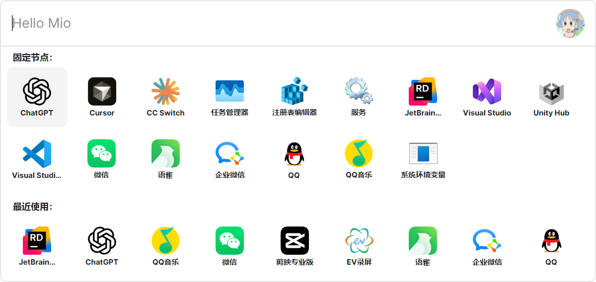
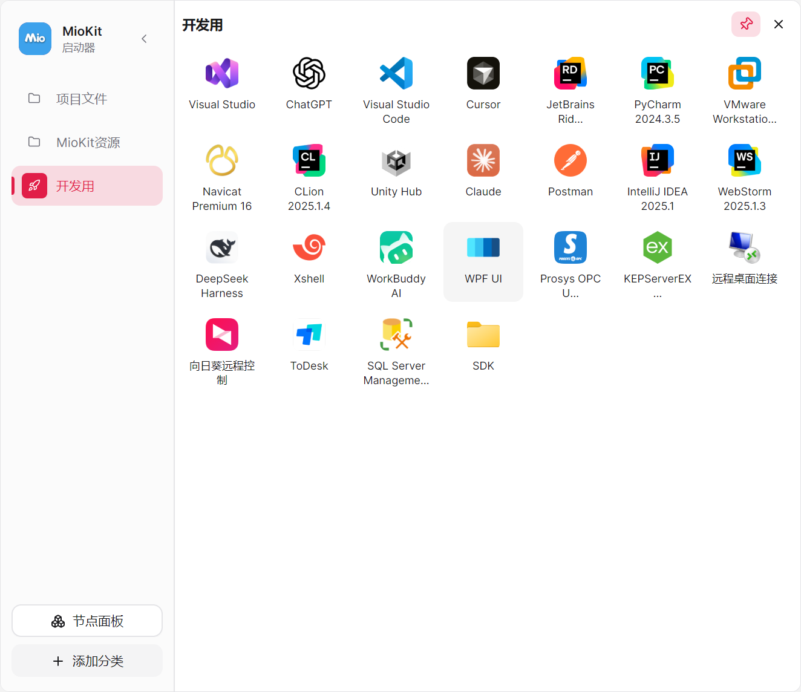
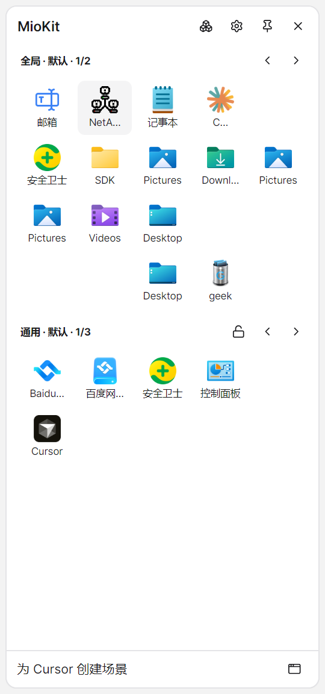
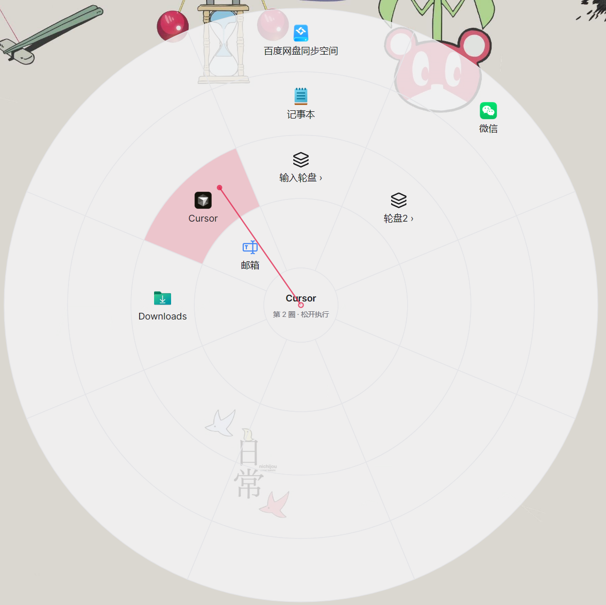
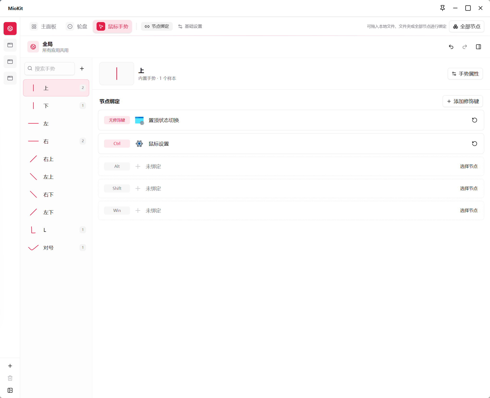
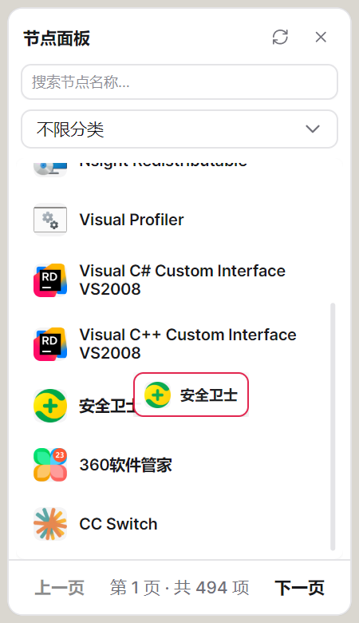

# MioKit

  <strong>Windows 上的效率工作台，让键盘和鼠标都顺手</strong>

  搜索、启动窗、主面板、轮盘与鼠标手势，共用应用、文件和插件节点，按自己的习惯组织工作流。

  <a href="https://apps.microsoft.com/detail/9n64fzj6nsk3">下载安装</a> ·
  <a href="https://www.tinyisle.cn/">官方网站</a> ·
  <a href="https://www.tinyisle.cn/plugins">浏览插件</a> ·
  <a href="docs/user-guide.md">用户指南</a> ·
  <a href="https://github.com/tiny-isle/MioKit/issues">问题反馈</a>

  

本仓库用于 MioKit 的功能介绍、使用说明、问题反馈和功能建议。

## 为什么使用 MioKit？

MioKit 把应用、文件、文件夹、系统入口和插件功能整理成可以复用的**节点**。例如，一个“项目目录”节点既可以通过搜索打开，也可以放进启动窗、主面板、轮盘，或绑定到鼠标手势。

临时查找时输入关键词，整理项目时使用分类，需要就近选动作时呼出轮盘，熟悉的操作则交给手势。各个入口共用已有节点，可以按自己的习惯搭配。

| 能力 | 说明 |
| --- | --- |
| 快速启动 | 启动桌面应用、Microsoft Store 应用和自定义启动项 |
| 分类启动窗 | 按项目或用途收纳应用、文件夹、文档与插件节点，支持拖入和排序 |
| 主面板 | 默认按鼠标中键呼出，全局区与应用区同时显示，支持动作页与按应用切换 |
| 轮盘与鼠标手势 | 通过鼠标选择或绘制轨迹执行节点，支持应用专属绑定 |
| 便捷拖拽 | 从置顶节点面板拖入已有节点，也可拖入本地文件和文件夹 |
| 文件与系统搜索 | 搜索文件、文件夹、Windows 设置并执行系统操作 |
| 高效输入 | 支持拼音、缩写和中英文混合搜索 |
| 上下文操作 | 结合当前窗口、剪贴板和资源管理器环境提供相关操作 |
| 插件扩展 | 添加新的搜索结果、可执行节点和独立工具界面 |

数据默认保存在本机，插件和功能可以按需启用。

## 快速开始

1. 从 [Microsoft Store](https://apps.microsoft.com/detail/9n64fzj6nsk3) 安装 MioKit。
2. 完成首次启动设置，等待准备完成后点击 **重启并进入**。重启后按 `Alt + Space` 呼出搜索框，输入应用或功能名称，选中结果后按 `Enter` 执行。
3. 按 `Ctrl + Space` 呼出启动窗，点击 **添加分类**，创建“工作”或“项目 A”；从资源管理器拖入常用文件、文件夹，按提示确认添加。
4. 按 **鼠标中键** 打开主面板，点击空格子选择节点，或打开标题栏的节点面板，将节点拖到格子中。
5. 想使用轮盘或鼠标手势时，右键 MioKit 托盘图标，进入 **动作配置**，设置布局或轨迹并绑定节点。

### 默认呼出方式

| 入口 | 默认操作 | 首次使用 |
| --- | --- | --- |
| 搜索框 | `Alt + Space` | 输入关键词查找内容 |
| 启动窗 | `Ctrl + Space` | 创建分类，再添加节点或拖入文件 |
| 主面板 | 鼠标中键 | 点击空格子添加节点 |
| 轮盘 | 按住鼠标右键并拖动 | 先配置至少一圈，并给扇区绑定节点 |
| 鼠标手势 | 按住侧键 X1 绘制，松开执行 | 先给手势轨迹绑定节点 |

以上是默认配置；已自定义的按键以本机设置为准。启动窗快捷键在 **设置 → 启动窗设置** 中修改；主面板、轮盘和手势在 **动作配置 → 对应模块 → 基础设置** 中调整。没有侧键的鼠标也可以重新选择手势触发按钮，注意与其他入口错开。

更多安装、首次启动和配置说明，请阅读[用户指南](docs/user-guide.md)。想直接照着搭一套工作流，可以从[使用场景](docs/guide/workflows.md)开始。

## 功能一览

### 搜索结果与快捷操作

输入关键词即可查看匹配结果，并通过结果菜单打开所在目录、复制路径、管理固定状态、设置全局快捷键、设置别名或执行插件提供的操作。

### 启动窗：按项目和用途收纳

默认按 `Ctrl + Space` 呼出，左侧选分类，右侧点选节点。可以分别建立“工作”“学习”“项目 A”，把相关应用、目录、文档和插件功能放在一起。

- 点击 **添加分类** 创建分组，右键内容区选择 **添加节点**，或打开 **节点面板** 拖入已有节点。
- 支持从资源管理器一次拖入多个文件或文件夹；已收录的项目直接加入，新项目确认名称和路径后保存添加。
- 拖动图标调整顺序，右键修改显示名称或图标；删除分类中的入口会保留原文件。
- 需要连续打开多个内容时，点击右上角钉住按钮，让窗口置顶并保持显示。

[查看启动窗教程](docs/guide/launcher.md)

### 主面板：跟随当前软件切换动作

默认按鼠标中键呼出，上方全局区保留常用节点，下方应用区显示当前软件对应的动作。没有匹配的应用配置时，下方显示通用配置。

- 点击空格子选择节点，或把节点、单个本地文件或文件夹拖到格子中。
- 在 **动作配置 → 主面板 → 节点绑定** 中添加应用、设置匹配进程，为不同软件安排各自的动作。
- 用多个动作页区分“常用”“项目”“工具”，通过分页按钮或格子区滚轮切换。
- 拖动格子移动或交换位置，跨页整理时可悬停分页箭头翻页后放入。

例如，在代码编辑器中显示项目文档和开发工具，在其他软件中显示通用工具；放在上方全局区的常用目录始终可用。

[查看主面板教程](docs/guide/main-panel.md)

### 轮盘：在鼠标周围选择动作

在 **动作配置 → 轮盘** 中设置圈层和槽位，再给扇区绑定节点。使用时按住触发按钮并拖动，轮盘出现后指向目标，松开按钮执行。默认触发按钮为鼠标右键，也可以改成中键或侧键。

- 可以用一圈放少量高频动作，也可以增加圈层容纳更多节点。
- 支持应用专属绑定，未覆盖的扇区继续使用全局动作。
- 支持子轮盘，将“项目工具”“更多工具”等内容放在同一入口下。指向子轮盘入口后松开进入，再用左键点击内部动作。

[查看轮盘教程](docs/guide/radial-menu.md)

### 鼠标手势：把熟悉的动作绑定到轨迹

在 **动作配置 → 鼠标手势 → 节点绑定** 中选择内置轨迹，为对应行绑定节点。默认按住侧键 X1 绘制，松开后执行；例如，将内置手势 **上** 绑定为打开项目目录。

- 同一轨迹可以搭配 `Ctrl`、`Alt`、`Shift`、`Win` 或组合修饰键，分别绑定不同节点。
- 可以为指定软件设置专属动作，让同一手势在不同软件中调用不同工具。
- 支持录制自定义轨迹、追加样本和识别测试，便于调整到习惯的画法。
- 画完继续按住并停顿，可以查看候选卡片，再移到目标卡片上松开执行。

手势需要先绑定动作。涉及插件功能时，先安装并运行相应插件，再选择其提供的可执行节点。

[查看鼠标手势教程](docs/guide/mouse-gestures.md)

### 便捷拖拽：找到一次，放到需要的位置

**节点面板** 是一个置顶小窗，可以搜索和筛选节点，适合连续整理多个入口。可从启动窗侧栏、主面板标题栏或动作配置中的 **全部节点** 打开。

1. 打开目标窗口，选好分类、应用范围、动作页或手势。
2. 在节点面板中找到需要的节点。
3. 拖到启动窗内容区、主面板格子、轮盘配置扇区或手势绑定行，松开完成添加或绑定。

也可以直接从资源管理器拖入本地文件、文件夹：启动窗支持批量添加，主面板格子与动作配置槽位每次接收单项。新路径会先提示确认收录，之后可以在其他入口继续复用。

[查看拖拽教程](docs/guide/drag-and-drop.md) · [了解节点与动作配置](docs/guide/actions.md)

### 自定义启动：为常用工作环境设置入口

在 **设置 → 快速启动 → 自定义启动** 中添加文件、文件夹，或拖入本地内容。程序启动项可设置启动参数、工作目录和管理员运行；集中存放便携软件的目录，也可以加入扫描配置后重新扫描。

每天都要打开同一组内容时，可以创建**启动组合**：从已收录的应用、系统入口、文件和文件夹中勾选成员，保存后把组合放进启动窗，或绑定到主面板、轮盘、手势。执行组合会同时发起成员的启动操作，不保证打开顺序。

[查看快速启动与启动组合教程](docs/guide/quick-launch.md)

### 插件扩展

插件可以把剪贴板、表达式计算、待办清单、网页快开、Everything 搜索等工具接入 MioKit，也可以提供独立界面。插件提供的可执行节点可以继续添加到启动窗或绑定到主面板、轮盘和手势，具体可用功能以已安装并运行的插件为准。

[浏览插件](https://www.tinyisle.cn/plugins) · [查看插件安装说明](docs/user-guide.md#插件)

### 设置与个性化

MioKit 支持主题模式、主题色、开机启动、全局快捷键、搜索结果管理和插件管理等设置。完整功能说明请查看[功能介绍](docs/features.md)。

## 可以怎样用？

| 场景 | 配置方式 | 日常使用 |
| --- | --- | --- |
| 每天开始一个项目 | 在启动窗创建项目分类，放入编辑器、目录和文档；需要一起打开时创建启动组合 | `Ctrl + Space` 打开分类，单独点选或执行组合 |
| 切换软件时使用不同工具 | 在主面板全局区放共用节点，为编辑器、浏览器分别配置应用区 | 按中键呼出，看到当前软件对应的工具 |
| 阅读和整理资料 | 把资料目录和已安装插件的常用功能放进轮盘，低频动作放入子轮盘 | 按住按钮拖动，指向需要的动作后松开 |
| 高频操作少一步选择 | 给简单手势绑定常用目录或工具，同一轨迹用 Ctrl 组合绑定另一个动作 | 按住手势按钮绘制，松开调用 |

可以先从搜索和一个启动窗分类开始，再逐步把高频节点放入主面板、轮盘或手势。[查看完整场景与配置步骤](docs/guide/workflows.md)。

## 文档

- [用户指南](docs/user-guide.md)：安装、首次启动、搜索操作、配置入口和插件安装。
- [功能介绍](docs/features.md)：浏览搜索、启动窗、主面板、轮盘、手势和插件能力。
- [详细功能资料](docs/product/README.md)：按功能整理的完整说明、配置项与场景，可供网站与帮助页面复用。
- [节点与动作配置](docs/guide/actions.md)：绑定节点、按应用切换与保存方式。
- 功能教程：[启动窗](docs/guide/launcher.md) · [主面板](docs/guide/main-panel.md) · [轮盘](docs/guide/radial-menu.md) · [鼠标手势](docs/guide/mouse-gestures.md) · [拖拽](docs/guide/drag-and-drop.md) · [快速启动](docs/guide/quick-launch.md)。
- [使用场景](docs/guide/workflows.md)：项目开工、软件专属工具和鼠标操作示例。
- [浏览 MioKit 插件](https://www.tinyisle.cn/plugins)：查看可用插件及其安装信息。

需要完整文档索引时，请查看[文档总览](docs/README.md)。

## 帮助与社区

- [问题反馈](https://github.com/tiny-isle/MioKit/issues/new?template=bug_report.md)
- [功能建议](https://github.com/tiny-isle/MioKit/issues/new?template=feature_request.md)
- [贡献指南](docs/contributing.md)
- [MioKit 官网](https://www.tinyisle.cn/)
- 插件开发：[MioKit.CodeAgent](https://github.com/tiny-isle/MioKit.CodeAgent)
