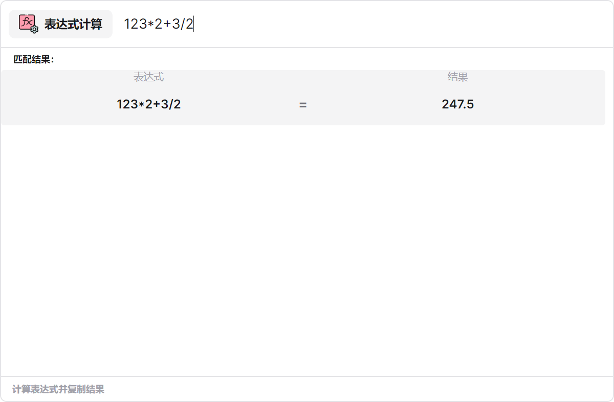
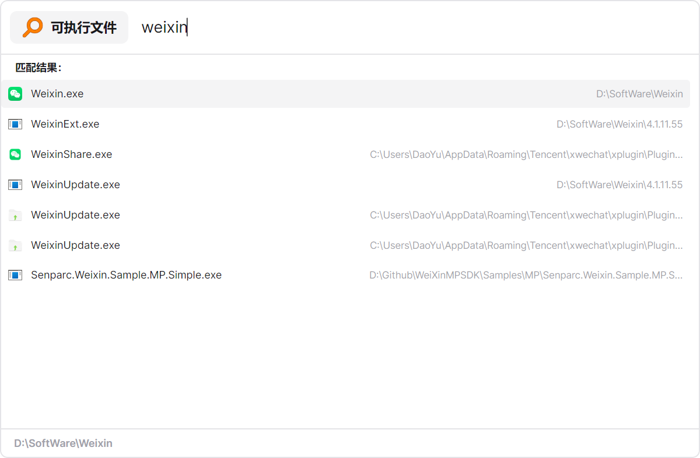
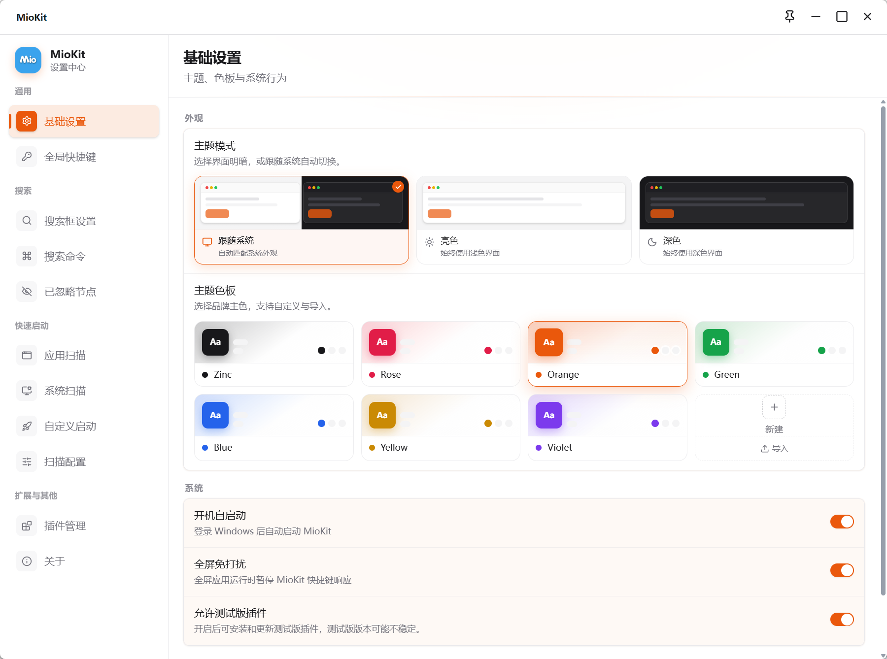

# 功能介绍

MioKit 是 Windows 上的效率工作台。搜索框、启动窗、主面板、轮盘和鼠标手势可以共用应用、文件、系统入口和插件的可执行节点，让查找、整理和调用功能衔接起来。

需要安装和配置步骤时，请阅读[用户指南](user-guide.md)；想按实际任务搭建工作流，可直接查看[使用场景](guide/workflows.md)。

更完整的功能范围、配置项、默认值和场景说明集中在[产品功能资料](product/README.md)，按功能独立编排，便于详细阅读及网站复用。

## 先选择适合的入口

| 要完成的任务 | 入口 | 开始方式 |
| --- | --- | --- |
| 临时查找应用或功能 | 搜索框 | 默认 `Alt + Space`，输入名称并执行 |
| 把某个项目需要的内容放在一起 | 启动窗 | 默认 `Ctrl + Space`，创建分类并添加内容 |
| 根据当前软件选择动作 | 主面板 | 默认鼠标中键，先填全局区，再按需配置应用区 |
| 在鼠标旁看选项后执行 | 轮盘 | 先设置圈层和绑定，再按住右键拖动呼出 |
| 用记住的轨迹调用动作 | 鼠标手势 | 先绑定轨迹，再按住侧键 X1 绘制后松开 |

可执行节点可以在多个入口复用。需要插件提供的功能时，先安装并运行相应插件；轮盘和手势初始没有动作绑定。表中按键为默认配置，可按习惯调整。

## 全局搜索与快速执行

按 `Alt + Space` 呼出搜索框，可查找桌面应用、Microsoft Store 应用、Windows 设置、控制面板、自定义启动项及插件功能。文件和文件夹的搜索范围取决于已收录内容与启用的搜索功能。

支持中文拼音、首字母缩写、中英文混合、名称和别名匹配。结果可直接执行，也可以通过右键菜单打开所在目录、复制路径、设置别名和快捷键，或调用节点提供的其他操作。

可以固定常用项目到首页、调整首页固定项顺序、查看最近使用，以及忽略不需要参与搜索的项目。已忽略的节点可在设置中心恢复。


## 启动窗：按分类整理节点

默认按 `Ctrl + Space` 呼出启动窗。它提供应用、文件夹、文档和插件节点的分类图标面板。可以创建“工作”“学习”或项目分类，从节点面板拖入已有节点，也可以一次拖入多个本地文件或文件夹。

分类和分类内图标支持拖动排序，启动项可自定义显示名称与图标。窗口支持呼出快捷键、位置和大小记忆、背景模糊、置顶，以及启动后或失焦后隐藏。

**适用场景：** 把一个项目的编辑器、目录和资料放在一起，按需点击打开。

操作步骤：[启动窗](guide/launcher.md)

## 主面板：全局与当前应用的动作

主面板把节点放进随时呼出的格子：上方全局区共用，下方应用区随当前软件切换，未匹配专属配置时使用通用内容。支持多个动作页、格子拖动和交换，也可以直接拖入节点或单个本地路径。

默认按鼠标中键呼出，也可配置键盘快捷键或中键修饰键。支持调整行列、格子尺寸、位置和隐藏行为，并设置全屏禁用、排除进程与全屏例外。动作页可在运行面板中新增、重命名或删除；应用场景可以临时锁定，之后再恢复自动匹配。

**适用场景：** 上方保留项目入口，下方在代码编辑器中显示开发工具，在其他软件中显示通用工具。

操作步骤：[主面板](guide/main-panel.md)

## 轮盘：在鼠标附近选择动作

按住设置的鼠标按钮拖动呼出轮盘，指向目标扇区后松开执行。支持多圈布局、子轮盘、显示名称与图标，以及应用专属绑定；未覆盖的槽位沿用全局内容。

可调整触发按钮、拖动阈值、显示圈数、每圈槽位与间距，在预览中安排常用动作的位置。

首次需要先配置可见圈层并绑定节点。指向子轮盘入口后松开会进入子轮盘，再用左键点击内部动作；按 `Esc` 可以取消。

**适用场景：** 阅读或整理资料时，在鼠标旁选择目录、剪贴板或插件工具；低频动作放进子轮盘。

操作步骤：[轮盘](guide/radial-menu.md)

## 鼠标手势：用轨迹执行节点

按住所选鼠标按钮绘制轨迹，松开后执行绑定节点。支持内置手势、自定义录制、追加样本、识别测试，以及 Ctrl、Alt、Shift、Win 和组合修饰键。

同一条手势可在不同应用中绑定不同节点，没有应用绑定时回退到全局的同一手势与修饰键组合。轨迹需要先绑定，不预设固定的浏览器或系统动作。

还可以画完后保持按住并停顿，查看候选卡片的名称和匹配度，再把指针移到候选上松开执行。适合刚熟悉轨迹、希望先确认结果的情况。

**适用场景：** 为每天反复执行的少量操作设置简单轨迹，熟悉后无需看菜单即可调用。

操作步骤：[鼠标手势](guide/mouse-gestures.md)

各入口画面见对应教程截图。

## 节点面板与便捷拖拽

节点面板是可搜索、可按类别筛选的置顶小窗。从这里把节点拖到启动窗分类、主面板格子、轮盘扇区或手势修饰键行，就能添加相应入口。

本地文件也可以直接拖入。启动窗与自定义启动页支持批量文件、文件夹；主面板和动作配置的指定槽位一次接收一个项目，已收录路径直接绑定，新路径确认名称和路径后添加。扫描配置还支持拖入文件夹作为扫描目录。

**适用场景：** 先把一批项目资料拖进启动窗，再把最常用的节点分配到主面板、轮盘或手势。

操作步骤：[拖拽与节点面板](guide/drag-and-drop.md)

## 快速启动与启动组合

设置中心可以管理应用扫描、系统扫描、自定义启动和扫描规则。自定义文件启动项可以设置启动参数、工作目录和管理员运行，已有节点可组成启动组合。

组合成员来自快速启动库中已收录的应用、系统入口、手动文件或文件夹，不能嵌套组合。执行会同时发起各成员，不保证完成顺序。已有启动项可继续编辑路径与参数，文件搬动后应更新路径并测试。

**适用场景：** 建立“项目 A 开工”组合，一次调用编辑器、目录和文档，再把组合放进喜欢的入口。

操作步骤：[快速启动](guide/quick-launch.md)

## 上下文感知

支持上下文的操作可以结合当前窗口、剪贴板、资源管理器路径或选中文件来执行。例如，相关插件可以在当前目录打开终端，或处理剪贴板内容。

是否使用这些信息，以及具体处理方式，由对应节点或插件决定。配置完成后，应在日常使用的软件中试用。

## Command 搜索作用域

Command 用于将搜索框切换到特定搜索作用域。输入完整触发词并按 `Tab` 后，后续输入交给该功能处理；输入前缀时若出现对应灰色补全提示，也可以直接按 `Tab`。

例如，提供 `calc` 和 `expression` 触发词的计算功能，可以通过下面的步骤进入：

```text
输入 calc → Tab → 输入 12 * 8
```



Everything 等插件也可以提供不同搜索作用域，分别使用不同的范围和过滤规则。用户可在 **搜索命令** 设置中，为支持的功能添加自定义触发词。

不记得触发词时，输入 `/` 查看可用作用域并执行进入。返回普通搜索时，清空输入后按 `Backspace`；有剪贴板上下文时会先解除它，文本还可能填入输入框，需清空后再退格返回。完整操作见[用户指南](user-guide.md#使用-command-搜索作用域)。



## 设置、快捷键与个性化

支持明暗模式、跟随系统、主题色板、自定义色板与导入导出、搜索框图标和欢迎语、最近使用、开机自启动、全屏免打扰与图标重建。搜索框、启动窗和主面板可分别配置呼出快捷键；支持快捷键的节点也可直接绑定组合键。



配置入口与常见问题见[用户指南](user-guide.md#设置与个性化)。

## 插件扩展

插件可提供搜索结果、可执行节点、结果菜单、Command、快捷键和自定义工具窗口。安装并运行后，插件的可执行节点也能加入启动窗、主面板、轮盘和手势。

已有文档中的插件方向包括快速输入、剪贴板、表达式计算、待办清单、终端指令、Everything 搜索等；请以对应插件实际提供的功能为准。


安装步骤见[用户指南](user-guide.md#插件)。

## 相关文档

- [节点与动作配置](guide/actions.md)：了解全局、通用和应用专属配置，区分绑定与保存。
- [使用场景](guide/workflows.md)：从任务出发组合不同入口。
- [用户指南](user-guide.md)：安装、设置和常见问题。
- [文档总览](README.md)：查看所有教程。

返回：[项目首页](../README.md)
