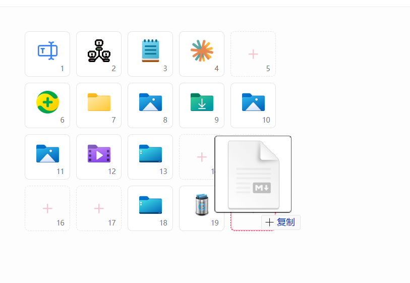

# 拖拽与节点面板

MioKit 支持把已有节点拖到常用入口，也支持把本地文件和文件夹拖入收录。可以先整理内容，再决定用启动窗、主面板、轮盘还是手势来执行。

## 用节点面板便捷拖拽

节点面板是一个置顶小窗，切换到配置窗口后仍会保留，适合连续查找和拖入节点。

可以通过以下入口打开：

- 搜索框中搜索 **节点面板** 并执行。
- 主面板标题栏的节点面板按钮。
- 启动窗侧栏的 **节点面板** 按钮。
- 动作配置右上角的 **全部节点** 按钮。

操作步骤：

1. 打开目标窗口，先选好分类、应用范围、动作页或手势。
2. 打开节点面板，在顶部搜索名称，或选择节点类别缩小范围。
3. 按住找到的节点，拖到目标位置。
4. 看到目标接受拖入的提示后松开，检查绑定结果。
5. 继续拖入其他节点，完成后关闭节点面板。

安装或启用插件后找不到新节点时，可以先点击面板的刷新按钮。

## 拖到哪里，会发生什么

| 目标位置 | 拖入已有节点后的结果 |
| --- | --- |
| 启动窗右侧内容区 | 添加到当前选中分类 |
| 主面板格子 | 绑定到这个格子 |
| 动作配置中的主面板格子 | 绑定到当前范围、当前动作页的格子 |
| 动作配置中的轮盘扇区 | 绑定到该扇区，也支持子轮盘内部 |
| 动作配置中的手势修饰键行 | 绑定到当前手势与对应修饰键组合 |
| 支持节点拖入的插件界面 | 按该插件提供的规则添加或绑定 |

这些操作创建入口或绑定，不会把原节点从来源处移走。执行型入口要求节点支持执行；节点面板里的其他类别是否可用，要看目标窗口的要求。

拖拽前请特别确认左侧选中的是 **全局**、**通用** 还是某个应用，以及当前动作页、子轮盘和手势。它们决定节点最后放在哪里。

## 从资源管理器拖入本地内容

本地文件或文件夹会先匹配已收录的启动节点。已经收录的可以复用；新路径需要确认名称和路径，再保存为启动项。

| 目标 | 一次可拖入什么 | 后续操作 |
| --- | --- | --- |
| 启动窗当前分类 | 多个文件或文件夹 | 已收录项目直接加入，其他项目确认后 **保存并添加** |
| 主面板某个格子 | 单个文件或文件夹 | 已收录路径直接绑定，新路径检查名称和路径后 **保存并添加** |
| 动作配置的主面板、轮盘或手势行 | 单个文件或文件夹 | 已收录路径直接绑定，新路径检查名称和路径后 **保存并添加** |
| 设置中心的 **自定义启动** | 多个文件或文件夹 | 在编辑窗口检查并保存启动项 |
| 设置中心的 **扫描配置 → 自定义扫描目录** | 多个文件夹 | 添加扫描目录规则，需要时重新扫描 |

把文件夹添加为启动项，是为了点击打开这个文件夹；把文件夹添加为扫描目录，是为了发现它里面的启动内容。请按用途选择入口。

批量拖入启动窗时，已收录项目会先加入，重复项目会跳过，剩余项目再进入确认窗口。部分项目失败时，按各项错误修改后重试；成功的项目无需重新添加，取消剩余确认也不会撤回已成功的内容。

拖入只负责添加或绑定，不会立即打开文件。后续要设置启动参数、工作目录等，可前往 **设置中心 → 快速启动 → 自定义启动**。

## 拖拽整理已有内容

- 启动窗：拖动分类图标调整分类顺序，拖动内容图标调整分类内顺序。
- 主面板：拖动格子进行移动或交换；跨页可在拖动时悬停分页箭头翻页，也可使用右键菜单中的 **移动 / 交换到其他页**。
- 主面板配置：拖动动作页标签排序，拖动格子调整绑定位置。
- 轮盘配置：把已有绑定拖到空扇区会移动，拖到已有绑定的扇区会交换。
- 手势配置：把已有绑定拖到同一手势的其他修饰键行，目标为空时移动，目标有绑定时交换。

需要找回刚改动的绑定时，可在动作配置节点绑定页使用可用的 **撤销 / 重做**。撤销文件导入后的绑定，不会删除已经收录的启动节点。

临时不需要某个入口时，在目标窗口移除入口或清除绑定即可。需要修改文件的启动路径、参数或工作目录时，到[自定义启动](quick-launch.md)编辑原启动项，再回到常用入口测试。

## 场景：快速搭好项目入口

在启动窗创建“项目 A”，从资源管理器一次拖入项目目录和文档，再从节点面板拖入开发工具。接着打开主面板，把最高频的目录节点拖到全局格子；在轮盘里给它安排一个顺手的方向。

以后修改入口布局时直接拖动绑定；同一个节点不必在每个入口重新创建。

## 拖不进去时

1. 检查目标是否正确，例如启动窗要先选分类，手势要拖到具体修饰键行。
2. 主面板和动作配置的指定槽位一次只接收一个本地项目，多项请逐个拖入。
3. 关闭未完成的编辑、选择或导入窗口，再试一次。
4. 确认文件路径仍存在、对应插件已运行、节点仍可用；刷新节点面板后重试。
5. 如果提示配置或目标已改变，重新选定目标并拖入。已收录成功的节点可以继续复用。

节点面板的拖拽用于当前运行的 MioKit 及支持此功能的界面；普通桌面程序是否能接收，取决于它自身的支持情况。

返回：[用户指南](../user-guide.md) · [节点与动作配置](actions.md) · [使用场景](workflows.md)

详细功能资料：[节点面板与便捷拖拽](../product/drag-and-drop.md)
