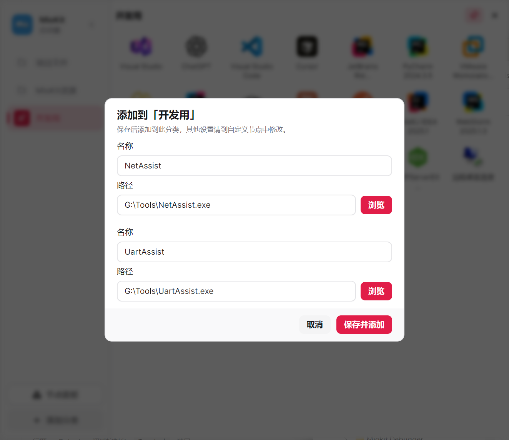

# 启动窗

启动窗是一块按分类整理的图标面板，可以收纳应用、文件夹、文档、系统入口和插件的可执行节点。适合把“工作”“学习”“某个项目”需要的内容放在一起，打开后点选使用。

部分界面也会使用 **启动器** 这个名称。它与[主面板](main-panel.md)是两个入口：启动窗侧重分类收纳，主面板侧重全局与当前应用的动作。

## 打开启动窗

1. 按默认快捷键 `Ctrl + Space` 呼出启动窗。
2. 如需修改，右键 MioKit 托盘图标选择 **设置**，进入 **启动窗设置 → 呼出快捷键**。
3. 点击当前快捷键，在录入面板中按下新组合，点击 **保存**；之后使用保存的组合呼出。

如果默认组合未生效，在同一设置项中检查实际保存的快捷键。首次设置时若检测到冲突，不会强行分配默认组合；已经自定义的快捷键也会保留。

## 创建分类

1. 点击左下角 **添加分类**。
2. 输入分类名称，例如“项目 A”。
3. 选择分类图标，点击 **保存**。
4. 选中这个分类，再向右侧添加内容。

右键分类可以 **修改分类** 或 **删除分类**。按住分类左侧的图标上下拖动，可以调整分类顺序。

删除分类会移除其中的启动项入口，原节点和磁盘上的文件仍保留。

## 添加内容

### 从已有节点中选择

1. 选中目标分类。
2. 在右侧内容区打开右键菜单，选择 **添加节点**。
3. 在选择器中找到目标节点并确认。

选择器会显示当前已加载、可执行且尚未添加到此分类的节点。同一个节点可以出现在不同分类中。

### 从节点面板拖入

1. 点击启动窗左下角 **节点面板**；侧栏收起时点击对应图标。
2. 在置顶小窗中搜索或按类别筛选节点。
3. 把节点拖到启动窗右侧内容区，松开后添加到当前分类。

这适合一次整理多个插件功能，例如把剪贴板管理、快速输入管理和计算工具放进“常用工具”。每个节点分别拖入即可。

### 从资源管理器拖入文件或文件夹

1. 选中启动窗的目标分类。
2. 在资源管理器中选中文件、文件夹或多个项目。
3. 拖到启动窗右侧，看到 **添加到当前分类** 后松开。
4. 已收录的项目会直接添加；尚未收录的项目会进入添加窗口，检查名称和路径后点击 **保存并添加**。
5. 同一分类里已有的项目会跳过，完成后检查添加结果。

启动窗支持一次拖入多个文件或文件夹。尚未创建分类时，请先添加分类。

批量导入可能先添加已有节点，再让你确认剩余项目。取消剩余项目的窗口不会撤回已经添加成功的内容；若有失败项，按各项提示修改后重试。

## 整理和执行

- 点击节点图标执行对应功能。
- 拖动分类内的图标，可以调整显示顺序。
- 右键启动项，使用 **修改名称** 或 **修改图标**，把它改成容易辨认的样子。
- 右键启动项选择 **删除**，移除这个分类中的入口，不会删除磁盘文件。
- 侧栏可以收起；窗口较窄时会自动收起，加宽后可再展开。
- 点击右上角的钉住按钮，窗口会置顶，并暂停失焦自动隐藏和启动成功后隐藏，适合连续打开多个项目。取消钉住后恢复设置中的隐藏行为；隐藏窗口后，本次钉住状态会解除。

修改名称只影响当前分类中这个入口的显示，不会重命名磁盘文件或修改其他入口。想恢复原名称时，再次打开 **修改名称**，将名称留空后保存。

## 调整窗口行为

在 **设置中心 → 启动窗设置** 中配置：

开关和下拉选项修改后直接保存，不需要另外寻找“保存设置”按钮。快捷键需要在录入面板中点击 **保存**。

| 设置 | 使用建议 |
| --- | --- |
| 打开位置 | 按自己的多屏使用习惯选择；记住位置时，每个屏幕分别保存 |
| 记住窗口大小 | 开启后重启仍保留大小；关闭后按默认尺寸打开，小屏会自动适配 |
| 重置位置和大小 | 找不到窗口或布局不合适时使用，下次打开生效 |
| 背景模糊、单元格大小、图标圆角 | 根据内容数量与辨识度调整 |
| 失焦自动隐藏 | 未钉住时，打开其他软件后自动收起启动窗 |
| 启动成功后隐藏 | 未钉住时，点击节点并成功调用后收起启动窗 |
| 记住上次分类 | 下次打开恢复上次分类；关闭后从第一个分类开始 |

临时连续打开多个项目时，直接钉住启动窗即可。如果希望平时也保持显示，可以关闭 **启动成功后隐藏** 和 **失焦自动隐藏**。

## 场景：为一个项目整理工作入口

创建“项目 A”分类，放入代码编辑器、项目目录、需求文档和浏览器；安装相关插件后，也可以放入项目常用的输入或工具节点。

每天开始工作时，呼出启动窗，选择“项目 A”，按需要点击打开；将当前不用的入口留在其他分类中。如果希望一次调用多个启动节点，可以另外创建[启动组合](quick-launch.md)，再把组合放进该分类。

## 常见问题

**为什么不能添加？** 先确认已选中分类，并关闭尚未完成的编辑或导入窗口。节点选择器只显示可执行且未加入当前分类的节点。

**插件功能没有出现在列表中？** 确认插件已运行，且对应功能提供了可执行节点。可以打开节点面板刷新后重试。

**为什么只删除了图标，搜索还能找到它？** 启动窗保存的是入口。要修改启动项本身，前往 **快速启动 → 自定义启动**；要卸载插件，前往 **插件管理**。

**输入类节点作用到错误窗口，或提示“目标窗口不可用”？** 先回到需要操作的软件，再按启动窗快捷键重新呼出。启动窗标题会显示本次操作目标；目标已经关闭时，需要重新选定目标。此项主要影响依赖目标窗口的输入或插件操作。

返回：[用户指南](../user-guide.md) · [拖拽说明](drag-and-drop.md) · [场景示例](workflows.md)

详细功能资料：[启动窗与分类收纳](../product/launcher.md)
