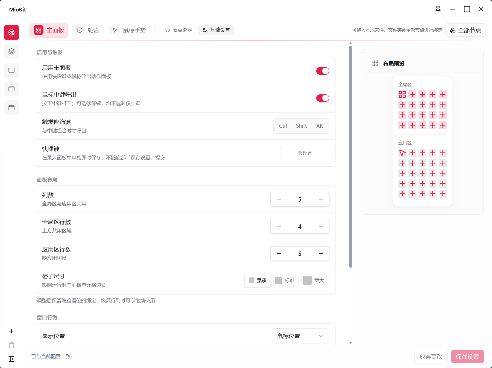

# 主面板

主面板是随时呼出的动作小窗。上方放所有应用共用的节点，下方随当前应用显示专属动作，适合在工作过程中直接点选常用功能。

默认已启用 **鼠标中键呼出**，不需要先设置键盘快捷键，也不需要同时按修饰键。先按一下中键打开面板，再添加常用节点即可。

## 第一次配置

1. 按鼠标中键打开主面板。
2. 点击上方全局区的一个空格子，选择一个常用节点。
3. 也可以点击标题栏的节点面板按钮，搜索节点后拖到格子中。
4. 点击已绑定的格子，检查执行效果；之后在其他软件中按中键也能呼出使用。

需要修改呼出方式时，右键托盘图标打开 **动作配置 → 主面板 → 基础设置**。可以单独设置键盘快捷键，或给中键搭配 `Ctrl`、`Shift`、`Alt`；修饰键均不选时仅用中键。基础设置改完点击 **保存设置**，快捷键则在录入面板中单独保存。

想集中整理多个格子时，进入 **主面板 → 节点绑定**，选中左侧 **全局** 或目标应用，再选择节点或从 **全部节点** 拖入。

需要添加本地文件时，可直接拖到格子；已收录的路径直接绑定，新路径检查名称、路径并确认添加。

## 全局区与应用区

全局区始终显示共用的动作；应用区根据本次操作目标选择应用专属配置。中键呼出时先把指针放在目标软件窗口内；键盘呼出时先激活目标软件。没有匹配专属配置时，显示 **通用** 配置。

例如，上方放“剪贴板”“项目文件夹”，下方在代码编辑器中放开发工具，在浏览器中放资料整理工具。配置方法见[应用专属配置](actions.md#添加应用专属配置)。

通用区与应用专属区是两套内容。希望在任何软件里都能看到的节点，应放在全局区。

应用区标题旁的锁定按钮可以 **锁定当前场景**，临时保持这一组动作。它的右键菜单也可以手动选择已有场景；手动选择后会保持该场景。需要继续跟随软件时，在场景菜单中选择 **自动匹配当前应用**。

还没有为当前软件配置时，面板底部会提供 **为当前应用创建场景** 的入口，也可以通过旁边的程序选择按钮创建。之后可继续填入节点，或到动作配置中集中整理。

## 直接在面板上整理

- 点击空格子选择节点。
- 从节点面板拖入已有节点，或从资源管理器拖入单个文件、文件夹。
- 拖动已有格子到另一个位置，可以移动；目标已有绑定时交换位置。
- 跨页整理时，可在拖动过程中悬停上一页、下一页按钮翻页，再放到目标格子；也可右键使用 **移动 / 交换到其他页**。
- 右键格子还可替换节点、修改显示名称，或 **移除面板绑定**。
- 顶部的节点面板按钮可以打开置顶节点小窗，适合边搜索边填充格子。

移除绑定只移除格子入口；原文件和插件节点仍保留。

## 用动作页容纳更多节点

全局区、通用区及各应用的专属区都可以有自己的动作页，例如“常用”“项目”“工具”。

在 **动作配置 → 主面板 → 节点绑定** 中，可以新增、复制、重命名、删除动作页；拖动页签可以排序。每套配置至少保留一个动作页，删除页面会同时移除该页绑定。

少量整理也可以直接在主面板完成：打开对应区域的页面菜单，选择 **添加动作页**、**重命名当前页** 或 **删除当前页**。全局区和应用区分别管理各自页面，最后一页不能删除。需要复制或调整页顺序时，再到动作配置集中整理。

刚添加的应用如果还没有动作页，请先点击 **新增动作页**，再向格子中绑定节点。

使用时通过区域的上一页、下一页按钮切换，也可使用页面菜单选择；在格子区滚动鼠标滚轮，可以切换该区域的动作页。键盘焦点位于格子上时，可用方向键移动，`PageUp` / `PageDown` 切换所在区域的动作页；`Esc` 隐藏面板。

## 调整布局与呼出行为

进入 **主面板 → 基础设置**：

| 设置 | 作用 |
| --- | --- |
| 列数、全局区行数、应用区行数 | 控制两个区域能显示多少格子，列数共用 |
| 格子尺寸 | 在紧凑、标准、宽大之间选择 |
| 显示位置 | 鼠标位置、屏幕中央或上次位置 |
| 失焦后隐藏、执行后隐藏 | 控制完成操作后是否自动收起 |
| 循环切换动作页 | 开启后翻过最后一页可回到第一页 |
| 全屏时禁用 | 避免全屏应用中意外呼出 |
| 排除进程 | 指定程序中不响应主面板呼出 |
| 全屏例外 | 开启全屏禁用后，允许指定程序在全屏中呼出 |

减少行列只会隐藏超出范围的格子，已有绑定会保留。恢复原来的行列数后可继续使用。修改后点击 **保存设置**。

标题栏的 **钉住面板** 会暂停失焦后隐藏和执行后隐藏，适合连续调用多个节点，或对照其他窗口整理格子。取消钉住后恢复基础设置中的隐藏行为。

钉住窗口与锁定场景分别控制两件事：钉住决定面板是否保持显示，锁定决定应用区使用哪组动作。需要面板保持打开且工具组固定时，可以同时使用。

## 场景：跟随软件切换工具

1. 全局区放经常使用的项目文件夹和剪贴板功能。
2. 为代码编辑器添加应用配置，在它的应用区放项目文档、终端工具等节点。
3. 在通用区放其他软件中也常用的工具。
4. 用同一个中键组合呼出：编辑代码时看到开发动作，其他软件中看到通用动作，上方全局入口始终可用。

示例中的插件功能需要先安装并启用对应插件；绑定列表中以实际可选节点为准。

## 常见问题

**中键或快捷键没反应？** 检查是否启用主面板、是否保存设置，以及是否要求同时按修饰键。再检查全屏禁用、排除进程和快捷键冲突。

**应用区不对？** 检查匹配进程，以及是否锁定了场景。关闭配置窗口后，在目标软件中重新呼出；应用尚无动作页时先创建一页。不要把全局、通用和应用专属三个编辑范围混淆。

**布局缩小后找不到节点？** 恢复行列数查看隐藏格子，或在原动作页中查找。

返回：[动作配置](actions.md) · [启动窗](launcher.md) · [使用场景](workflows.md)

详细功能资料：[主面板与应用动作](../product/main-panel.md)
