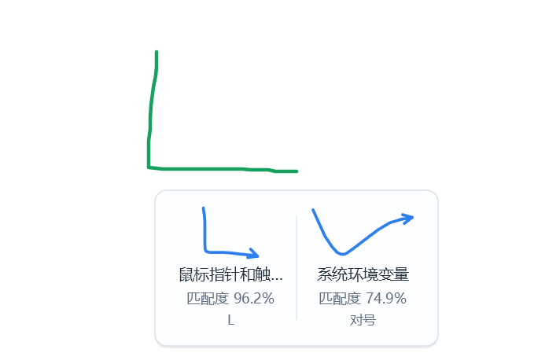
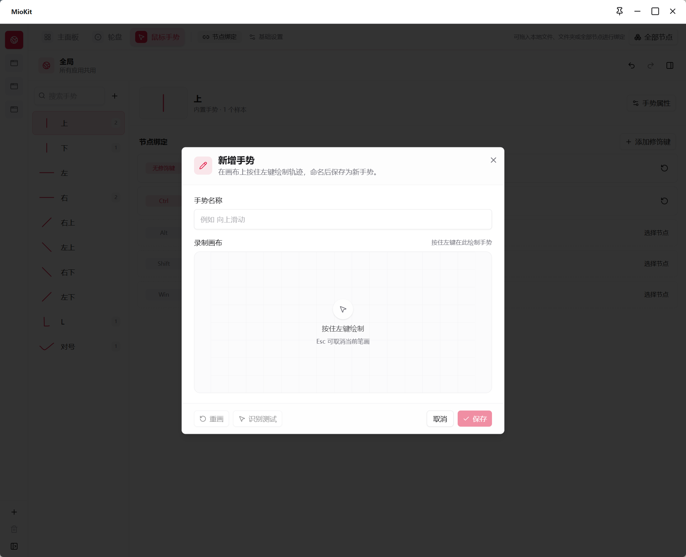

# 鼠标手势

鼠标手势通过绘制轨迹调用节点。例如，按住侧键向上划动后松开，打开常用文件夹；同一轨迹也能搭配不同修饰键，执行不同功能。

手势可以绑定任何当前可用的可执行节点，包括插件功能。它没有固定的“向左一定后退”之类规则，需要先绑定动作。

默认已启用手势，触发按钮为 **侧键 X1**，执行阈值为 **80%**，候选停顿为 **800 毫秒**。初始没有动作绑定，需要先为轨迹选择节点。

## 第一次配置

1. 右键 MioKit 托盘图标，打开 **动作配置 → 鼠标手势 → 基础设置**。
2. 确认 **启用手势** 已开启。可以保留默认侧键 X1，也可以改为右键、中键或侧键 X2。同一时间只使用一个触发按钮。
3. 第一次先保留现有识别参数，点击 **保存设置**。
4. 进入 **节点绑定**，左侧选择 **全局**，在手势列表中选择一个内置手势。
5. 在 **无修饰键** 对应行选择节点；也可以双击该行选择，或把节点从 **全部节点** 打开的节点面板拖到该行。
6. 切回日常使用的软件，按住设定的鼠标按钮，画出对应轨迹，再松开按钮执行。

可以先绑定“打开一个文件夹”来测试。仅启用手势、没有绑定节点时，不会自动产生动作。

绘制时需要画出清楚的一段，轨迹过短不会执行。绘制过程中可按 `Esc` 取消。

## 停顿后选择候选

刚开始使用、不确定会匹配哪条手势时，可以先看候选再决定：

1. 按住触发按钮绘制轨迹，画完继续保持按住。
2. 停顿片刻，等待候选卡片出现；默认候选停顿为 800 毫秒。
3. 查看卡片上的动作名称、匹配度和手势名称，将鼠标移到想执行的卡片上。
4. 松开触发按钮，执行所选动作。

在候选卡片外松开，或选择标为未绑定动作的候选，都不会执行。候选出现后仍可按 `Esc` 取消。熟悉轨迹后可以画完直接松开，由最佳候选与执行阈值决定是否自动执行。

## 用修饰键扩展同一条手势

同一轨迹可以分别设置无修饰键、`Ctrl`、`Alt`、`Shift`、`Win` 的动作，还可以点击 **添加修饰键**，勾选多个键创建组合。

例如，选择内置手势 **上**，将其无修饰键动作配置为打开项目目录，将 `Ctrl + 上` 配置为打开需求文档。使用后者时，先按住 Ctrl，再按手势触发按钮开始绘制，画完后松开鼠标按钮。中途补按修饰键不用于改变本次手势的组合。

每一种组合单独绑定。增加组合行后，还需要为它选择节点；没有绑定的组合不会自动改用“无修饰键”的动作。

同一条手势的绑定行之间可以拖动已有动作，调整它对应的修饰键组合；拖到空行会移动，拖到已有绑定的行会交换。移除应用专属绑定后，该组合会重新使用全局的同一组合绑定。

## 录制自己的手势

1. 在手势列表旁点击 **新增手势**。
2. 输入容易记住的名称，例如“折线打开项目”。
3. 在录制画布中按住 **鼠标左键** 绘制一条轨迹，松开结束。
4. 不满意时点击 **重画**；绘制过程中可按 `Esc` 取消当前笔画。
5. 需要检查与现有手势是否混淆时，点击 **识别测试**。此时只匹配已保存且启用的手势，尚未保存的新手势不会出现在候选中。
6. 满意后点击 **保存**。
7. 保存后，在 **手势属性 → 识别测试** 中确认能匹配新手势，再给它绑定节点，最后在实际软件中用设置的触发按钮测试。

录制画布使用左键，日常触发使用基础设置中选择的鼠标按钮，两者操作位置与用途不同。

## 管理手势与识别效果

选中手势，点击 **手势属性**：

- 内置手势可以启用、停用、绑定节点和做识别测试，名称只读。
- 自定义手势可以改名、重新录制、追加样本、启用或停用。
- **重新录制** 用新的轨迹替换当前样本；**追加样本** 为同一动作增加另一条绘制示例。
- **识别测试** 可以在绑定动作前检查轨迹，避免试用时直接执行节点。
- 删除自定义手势会同时删除所有应用中这个手势的绑定。

如果识别不稳定，先用识别测试观察是否总被认成另一个手势。优先让轨迹差异更明显，再按需要追加符合日常画法的样本。

在 **基础设置** 中：

| 参数 | 作用与调整方法 |
| --- | --- |
| 执行阈值 | 直接松开时，最佳候选达到此分数才自动执行；调高需要更准确，调低更容易混淆。停顿后主动选择候选时，以所选卡片为准 |
| 候选停顿 | 显示识别候选前的等待时间，单位毫秒；不等同于要求一直按住这么久才可执行 |

修改后点击 **保存设置**，再回到实际使用环境测试。

需要临时停用时，关闭 **启用手势** 并点击 **保存设置**。以后重新开启，原来的手势和绑定仍可继续使用。

## 按应用改变同一手势

在左侧添加应用并配置匹配进程后，选择它，再绑定手势和修饰键组合。

例如，全局手势 **上** 打开常用目录，在代码编辑器里把同一手势改为打开该项目的开发工具节点。其他软件仍使用全局动作。应用未设置的组合会回退到全局的同一组合，详见[动作配置](actions.md)。

## 场景：把最常用的两个动作记在手上

先只设置两条容易区分的轨迹：一条打开常用目录，一条调用已安装插件提供的常用功能。使用熟练后，再增加修饰键或应用专属动作。需要看选项才能决定时，可以使用[轮盘](radial-menu.md)；已经记住动作时，手势更直接。

## 常见问题

**看到轨迹却没有执行？** 检查对应手势是否启用、当前应用和修饰键组合有没有绑定、目标节点是否可用，以及测试分数是否达到执行阈值。

**候选已经出现，松开却没执行？** 先把指针移到已绑定动作的候选卡片上再松开；在卡片外松开会取消。若轨迹过短，重新画出清楚的一段再试。

**总触发错功能？** 先检查当前应用配置和修饰键，再做识别测试。相似轨迹可调整画法或提高阈值。

**与轮盘抢同一个按钮？** 给两个功能选择不同按钮，并检查主面板中键设置，详见[场景中的入口分工](workflows.md#场景五让键盘鼠标各司其职)。

返回：[动作配置](actions.md) · [拖拽说明](drag-and-drop.md) · [使用场景](workflows.md)

详细功能资料：[鼠标手势与候选选择](../product/mouse-gestures.md)
