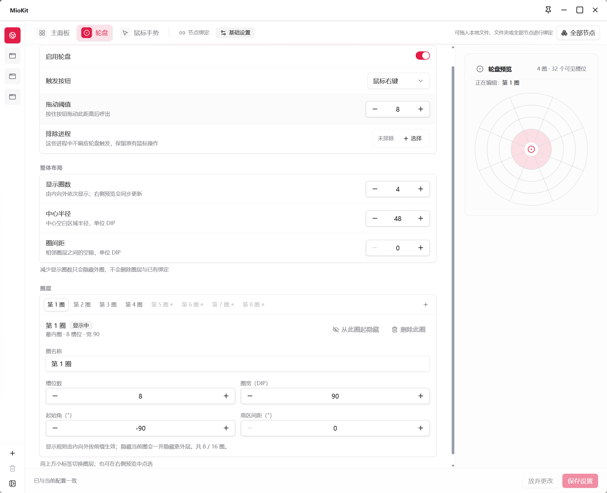
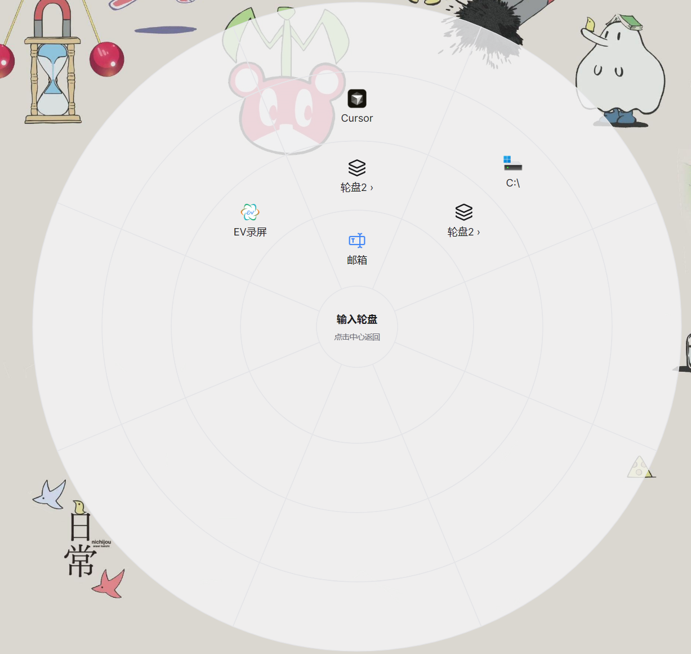

# 轮盘

轮盘把节点放在鼠标周围的扇区中。按住设定的按钮并拖动即可呼出，移动指针选择目标后松开执行，适合不想离开当前操作位置去搜索或点击远处图标的场景。

默认已启用轮盘，触发按钮为 **鼠标右键**，拖动阈值为 **8**；初始没有圈层，需要先配置至少一圈，轮盘才有可显示的位置。

## 第一次配置

1. 右键 MioKit 托盘图标，打开 **动作配置 → 轮盘 → 基础设置**。
2. 确认 **启用轮盘** 已开启。可以保留默认右键，也可以将 **触发按钮** 改为中键、侧键 X1 或侧键 X2。
3. 设置 **显示圈数**，并确保可见圈层的 **槽位数** 大于 0。第一次可以先用一圈、少量槽位。
4. 点击 **保存设置**。
5. 进入 **节点绑定**，左侧选择 **全局**。
6. 点击扇区，在绑定属性中选择节点；也可以双击扇区选择，或从 **全部节点** 打开的节点面板拖入。
7. 切回日常使用的软件，按住触发按钮并拖动，轮盘出现后指向已绑定的扇区，再松开按钮。

初次测试建议绑定一个打开文件夹的节点，方便确认结果。

## 日常操作

按住触发按钮后，需要移动超过 **拖动阈值** 才会呼出。出现轮盘后保持按住，观察目标高亮，再松开执行。需要取消时可按 `Esc`。

只短按、没有拖到触发距离时，保留普通鼠标点击。轮盘已经出现后，也可以回到中心空白区域再松开，取消本次动作。

同一个扇区可以绑定应用、文件夹、系统入口或插件可执行节点。轮盘提供的是另一种调用入口，具体动作取决于绑定的节点。

临时需要使用鼠标原本的拖动操作时，到 **轮盘 → 基础设置** 关闭 **启用轮盘** 并点击 **保存设置**。重新启用后原有布局和绑定仍可继续使用。

## 为不同软件设置不同动作

1. 在左侧添加或选择目标应用，配置匹配进程。
2. 在该应用的轮盘中，只绑定需要区别于全局的扇区。
3. 切回目标应用，重新呼出轮盘测试。

应用没有设置的槽位使用全局绑定。因此可以保留多数通用动作，只替换少数扇区。应用编辑画布展示本应用的绑定，未显示的全局内容可切到 **全局** 查看。

匹配到应用专属配置后，主轮盘有三页，依次为 **全局内容**、**应用与全局合并后的内容**、**仅应用专属内容**，默认从合并页开始。鼠标滚轮向上切到前一页，向下切到后一页；中心下方的圆点标记当前页，到首尾后不循环。

例如，全局的左侧放“项目目录”，右侧放“剪贴板”；在资料整理软件里，把右侧改为常用的资料工具，左侧仍使用全局入口。

## 圈层和布局

在 **轮盘 → 基础设置** 中，可以边调整边查看预览：

| 设置 | 怎样使用 |
| --- | --- |
| 拖动阈值 | 太容易误呼出时调大；需要移动很远才出现时调小 |
| 显示圈数 | 从内向外决定显示多少圈，最多 16 圈 |
| 中心半径 | 调整中心空白区域大小 |
| 圈间距 | 拉开相邻圈层，减少视觉拥挤 |
| 圈名称 | 方便在配置时辨认每一圈 |
| 槽位数 | 决定这一圈划分多少个扇区 |
| 圈宽 | 调整这一圈的宽度 |
| 起始角 | 旋转扇区布局，让常用动作落在顺手的方向 |
| 扇区间距 | 调整扇区之间的空隙 |

点击圈层标签或预览中的圈层可切换编辑对象。**显示到此圈** 会连同更内侧的圈显示；**从此圈起隐藏** 会连同更外侧的圈隐藏。

减少显示圈数或槽位数会保留超出范围的绑定，恢复后可再次显示。**删除此圈** 并保存则会移除全局、各应用和各子轮盘在这一圈的绑定，保存基础设置也会重置撤销历史。修改布局后点击 **保存设置**，再检查节点位置。

## 用子轮盘整理更多动作

子轮盘可以把一组动作放到同一个入口下，例如主轮盘放“项目工具”，里面再放项目目录、文档和常用应用。

1. 在 **轮盘 → 节点绑定** 点击工具栏 **子轮盘**。
2. 点击 **新建**，填写名称，打开该子轮盘并绑定内部节点。
3. 通过画布上方的路径回到 **主轮盘**。
4. 选中一个扇区，在绑定属性中点击 **选择子轮盘**，选择刚创建的轮盘。
5. 使用时按住触发按钮呼出主轮盘，指向子轮盘入口后 **松开按钮**，进入子轮盘；随后使用 **鼠标左键点击** 其中的动作。

子轮盘不会仅因鼠标悬停就展开。进入后可左键点击中心区域返回上级，或按 `Esc` 取消。

子轮盘可以复用到多个入口。修改同一个子轮盘的内容会影响引用它的入口；需要不同内容时，先在管理列表中复制。仍被引用的子轮盘不能直接删除，应先清除对应入口。

绑定画布中的已有动作可以拖到其他扇区整理：目标为空时移动，目标有绑定时交换。还可为入口单独设置名称、描述和图标，修改显示信息后点击 **保存**。

## 场景：鼠标旁的项目工具箱

将项目目录、需求文档、剪贴板和常用输入节点放在一圈。阅读或编辑时按住侧键拖出轮盘，朝熟悉的方向选择，松开即可调用。低频工具收进“更多工具”子轮盘，主轮盘保留少量常用入口。

## 常见问题

**启用了却没有轮盘？** 检查触发按钮、拖动阈值，以及是否至少有一个可见且槽位数大于 0 的圈层。仅轻按按钮不会满足拖动呼出条件。

**轮盘出现但不执行？** 确认目标扇区有绑定，节点当前可用，并在松开前观察高亮。

**与手势或主面板争用鼠标键？** 为三种入口设置不同的按钮或组合，例如主面板用 `Ctrl + 中键`、轮盘用 X2、手势用 X1。先分别测试，再一起使用。

**清除了应用绑定，为什么仍会执行？** 该槽位可能回退到全局动作。切换到全局检查绑定；匹配应用时，也要留意当前查看的是全局、合并还是仅应用页。

返回：[动作配置](actions.md) · [鼠标手势](mouse-gestures.md) · [使用场景](workflows.md)

详细功能资料：[多圈轮盘与子轮盘](../product/radial-menu.md)
