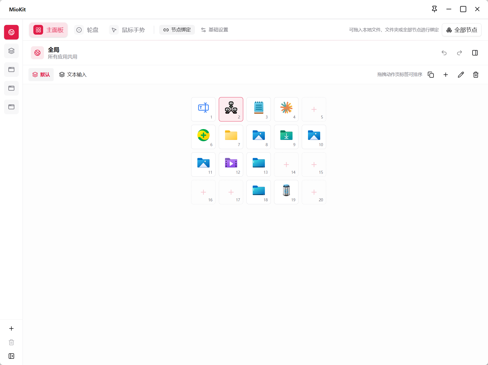
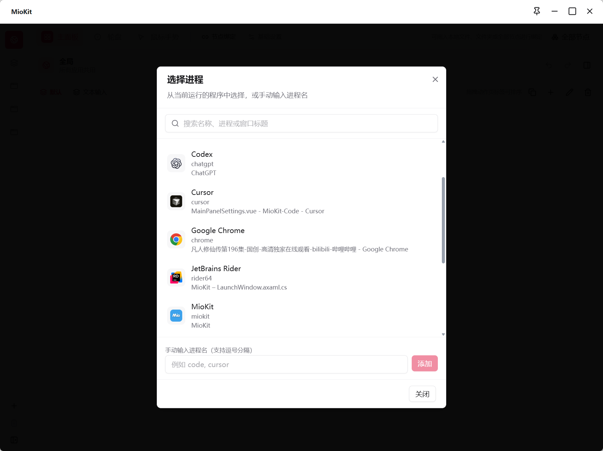

# 节点复用与动作配置

节点是 MioKit 中可以被查找、组织和调用的内容。应用、目录、文档、系统入口和插件条目都可以用节点表示。支持执行的节点，可以添加到启动窗，或绑定到主面板格子、轮盘扇区和鼠标手势。

节点本身维护功能与内容；各入口保存对节点的引用及显示安排。同一个目录放进多个入口后，仍然调用同一个节点。移除一个入口不会删除原文件，也不会卸载提供节点的插件。

## 选择合适的调用位置

| 位置 | 整理方式 | 典型用途 |
| --- | --- | --- |
| 搜索框 | 按名称查找 | 临时访问或未提前归类的内容 |
| 启动窗 | 分类与图标 | 项目资料、常用应用和工具分组 |
| 主面板 | 全局区、应用区与动作页 | 随软件切换的一组动作 |
| 轮盘 | 圈层、方向和子轮盘 | 在指针附近选择动作 |
| 鼠标手势 | 轨迹与修饰键组合 | 熟悉的高频调用 |
| 节点快捷键 | 一个组合键直接执行 | 少量最常用的节点 |

可搜索、可执行和支持快捷键分别取决于节点能力。选择器只提供当前可以用于相应操作的内容，不能把任意管理项都拖进执行位置。

## 打开动作配置

右键 MioKit 托盘图标，选择 **动作配置**。窗口包含 **主面板**、**轮盘**、**鼠标手势** 三个模块，每个模块分为 **节点绑定** 与 **基础设置**。

节点绑定决定调用什么，基础设置决定呼出方式、布局或识别参数。启动窗分类直接在启动窗整理，它的快捷键与窗口选项在 **设置 → 启动窗设置**。

## 添加、更换与清除绑定

1. 选中模块，再选择左侧的全局或目标应用；主面板还可选择通用。
2. 选中具体位置：主面板格子、轮盘扇区，或手势的修饰键行。
3. 点击 **选择节点**，在选择器中查找并确认；也可双击支持的目标直接选择。
4. 需要连续添加时，用 **全部节点** 打开置顶节点面板，再逐个拖入。
5. 修改已有位置时使用 **更换节点** 或 **清除绑定**。
6. 回到目标软件，用日常触发方式执行检查。

本地文件和文件夹也能拖入指定位置。已收录路径直接复用，新路径需要先在添加窗口确认。绑定时新增的启动项会留在启动库中。

## 三类配置范围

### 主面板

全局区始终显示共用内容。应用区使用匹配应用自己的动作页；没有匹配时显示通用配置。通用不是每个专属应用下方自动叠加的另一组格子，需要一直可见的节点应放全局区。

### 轮盘

应用覆盖同一圈、同一槽位的全局绑定，未覆盖的槽位使用全局内容。运行时可以切换全局、合并、仅应用三页。圈层布局共用，应用专属仅改变内容。

### 手势

按“轨迹 + 完整修饰键组合”查找应用绑定，找不到时回退全局同项。例如应用的 `Ctrl + 上` 没有绑定时，会找全局 `Ctrl + 上`，不会改用无修饰键的 **上**。

因此，清除应用的轮盘或手势绑定后，仍可能执行全局动作。编辑页展示本应用自己的绑定，不等于把运行时合并后的内容全部画出来。

## 新建应用配置

1. 先运行目标软件，在动作配置点击 **添加应用**。
2. 填写便于识别的名称，通过 **选择进程** 添加至少一个匹配进程，也可以手动填写。
3. 需要让其他程序共用这套工具时，用 **选择关联程序** 添加。
4. 点击 **添加应用** 保存资料。
5. 分别到三个模块填写绑定；动作配置中的主面板还没有动作页时，先新增一页。
6. 将指针放到目标软件窗口内，使用中键、轮盘或手势测试；键盘呼出主面板时先激活目标软件。

应用资料由三个模块共享，只需添加一次；各模块的节点内容分别设置。相同进程不能作为两个应用的直接匹配进程，同一关联程序也不能重复归属；直接匹配配置优先于关联程序匹配。

匹配按程序进程区分，不能仅通过给配置改名来识别同一编辑器打开的不同项目。此类内容可以用动作页或启动窗分类组织。

## 配置修改的作用范围

| 修改内容 | 影响范围 |
| --- | --- |
| 当前位置的节点绑定 | 当前模块、当前配置和位置 |
| 应用名称、匹配进程、关联程序 | 三个动作模块共享的应用资料 |
| 删除一个应用 | 该应用在三个模块中的专属配置 |
| 轮盘圈层与触发按钮 | 全局和所有应用共用布局与触发方式 |
| 子轮盘内容 | 引用该子轮盘的所有入口 |
| 手势名称、样本和启停 | 所有应用共用的轨迹库 |
| 删除自定义手势 | 全局与所有应用中对应轨迹的绑定 |

## 保存与撤销

| 操作 | 生效方式 |
| --- | --- |
| 选择、拖入、移动、交换、清除绑定和整理动作页 | 成功后直接保存 |
| 基础设置草稿 | 点击 **保存设置** |
| 绑定属性的名称、描述和图标 | 点击属性区域的 **保存** |
| 快捷键 | 在录入面板单独保存 |
| 应用资料、手势录制等对话框 | 在当前窗口确认保存 |
| 启动窗设置中的开关与选项 | 修改后直接保存 |

节点绑定页支持 `Ctrl + Z` 撤销，`Ctrl + Y` 或 `Ctrl + Shift + Z` 重做，以按钮可用状态为准。基础设置保存、应用资料或手势本身修改后，历史会重置；输入框、对话框或未保存草稿也可能限制快捷键操作。

撤销绑定不会删除因文件导入新建的启动项。删除圈层、删除应用或手势时，不应依赖之前的撤销历史恢复整套内容。

## 实际使用与排查

先把项目目录放进全局主面板，再在编辑器配置里放项目文档；轮盘保留相同目录，在编辑器中仅覆盖一个工具槽位。这样可在保留共用动作的同时增加专属内容。

节点暂不可用时，检查原路径、插件运行状态和条目是否已被删除。选择器找不到内容时，清空筛选并确认节点支持执行，再重新打开选择器或刷新节点面板。

继续阅读：[主面板](main-panel.md) · [轮盘](radial-menu.md) · [鼠标手势](mouse-gestures.md) · [拖拽](drag-and-drop.md)

返回：[产品功能资料](README.md)
