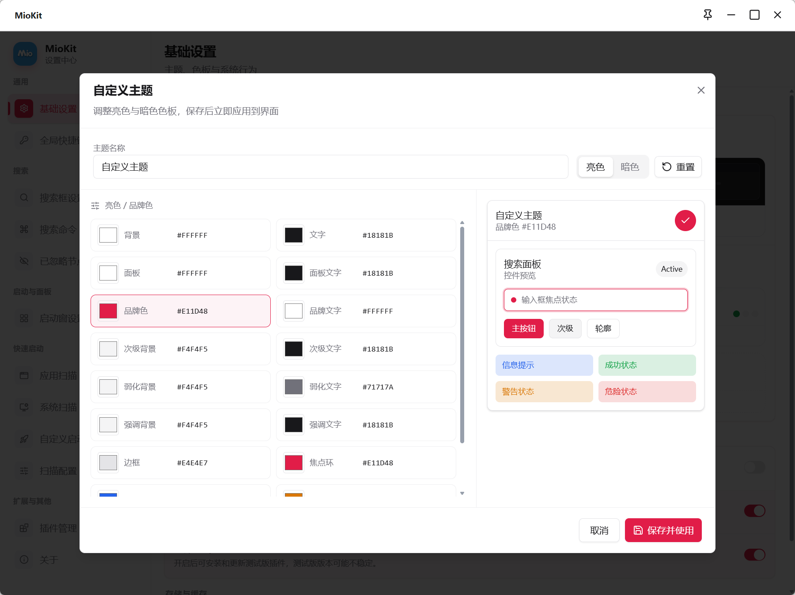

# 设置与个性化

MioKit 的设置分为设置中心与动作配置。设置中心管理外观、搜索框、启动窗、快速启动和插件；动作配置管理主面板、轮盘和手势的绑定与基础参数。

两者都可从托盘右键打开。先确认要改变的是全局外观、某个窗口行为，还是具体动作的触发方式，再选择对应入口。

## 配置入口对照

| 想调整的内容 | 入口 |
| --- | --- |
| 明暗、色板、自启动、全屏免打扰、图标维护 | 设置 → 基础设置 |
| 搜索呼出、窗口位置、欢迎语与最近使用 | 设置 → 搜索框设置 |
| 专用搜索触发词 | 设置 → 搜索命令 |
| 已有节点组合键 | 设置 → 全局快捷键 |
| 恢复忽略的搜索项 | 设置 → 已忽略节点 |
| 启动窗尺寸、外观和隐藏 | 设置 → 启动窗设置 |
| 主面板、轮盘、手势的触发与布局 | 动作配置 → 对应模块 → 基础设置 |

## 明暗模式与色板

主题模式可以选择 **跟随系统**、**亮色** 或 **深色**。它控制界面明暗；主题色板控制配色，两者可以分别调整。

在 **基础设置 → 外观** 选择色板。新增自定义主题时，以当前选中色板为基础填写名称，分别调整亮色和暗色，查看预览后点击 **保存并使用**。

名称不能为空，也不能与现有主题冲突或覆盖内置主题名称。自定义主题可以继续编辑、重置草稿颜色或删除；删除正在使用的自定义主题后会恢复内置默认色板。

### 导入与导出

自定义色板支持文件导入导出。导出需要分享或保存的色板，导入时选择对应主题文件并查看提示。文件格式无效或与内置名称重名时，需要先处理错误。

色板导入导出只处理色板，不代表启动窗分类、快捷键、轮盘和插件数据也一并迁移。

## 搜索框设置

| 设置 | 选项或作用 | 使用说明 |
| --- | --- | --- |
| 呼出快捷键 | 默认 Alt + Space，可修改 | 在录入面板保存 |
| 窗口位置 | 屏幕上方 1/5、上方 1/4、记住位置 | 按自己的屏幕使用习惯选择 |
| 搜索框图标 | 替换右侧 MioKit 图标 | 支持 PNG、JPG/JPEG、WebP、ICO，可恢复默认 |
| 欢迎语 | 空闲时的提示文字 | 适合填写简短提示 |
| 显示最近使用 | 呼出时展示最近节点 | 需要时关闭，保留更简洁首页 |
| 主页标题折叠 | 长标题以省略号显示 | 改变标题显示，不删除内容 |
| 关闭后清除搜索内容 | 立即、3 秒、10 秒、不自动清除 | 实际控制附加面板保留时间，详见下文 |
| 自动粘贴 | 禁用、3/5/10/15/20/30 秒 | 当前剪贴板上下文的有效时间窗口 |

### 隐藏后究竟保留什么

搜索框关闭时，输入、结果和剪贴板预览会立即清除。**关闭后清除搜索内容** 的时间设置只控制附加面板保留多久再卸载；选择不自动清除，不等于永久保留上次输入和所有搜索结果。

自动粘贴用于相应剪贴板上下文的时间策略，不能解释成定时向任意窗口粘贴。具体流程见[操作目标与上下文](context.md)。

## 三类快捷键和鼠标触发

| 类型 | 设置方式 | 示例 |
| --- | --- | --- |
| 呼出窗口 | 搜索框、启动窗设置，或主面板基础设置 | 默认 Alt + Space、Ctrl + Space |
| 直接调用节点 | 支持的节点操作菜单，之后在全局快捷键集中管理 | 某个常用目录的组合键 |
| 鼠标调用 | 对应动作模块的基础设置 | 中键面板、右键轮盘、X1 手势 |

全局快捷键页用于查找已有绑定、录入新组合或移除组合。录入后按窗口提示保存，并在日常环境试用。

鼠标按钮不够时，逐个选择功能测试；主面板可以增加 Ctrl、Shift、Alt 修饰键，轮盘与手势分别选择触发按钮。示例分工不等于本机默认配置。

## 开机自启动与插件自动启动

基础设置的 **开机自启动** 决定登录 Windows 后是否启动 MioKit。若由系统管理，按页面提示打开 Windows 启动应用设置处理。

插件详情中的 **自动启动** 决定 MioKit 启动时是否加载运行该插件。它与 Windows 是否先启动 MioKit 是两个层次的设置；当前运行状态也与下次自动启动选择分别管理。

## 全屏响应

基础设置的 **全屏免打扰** 用于全屏应用运行时暂停 MioKit 快捷键响应。测试快捷键没反应时，应先判断是否处于全屏环境。

主面板另外提供 **全屏时禁用**、**排除进程** 与 **全屏例外**。全屏例外只用于它自身的全屏禁用规则，不能绕过排除进程。不要将两处设置当成完全相同的开关。

## 图标维护

图标异常、更新后仍显示旧图时，可在 **基础设置 → 存储与缓存 → 重建图标** 手动执行。操作完成后查看已重建、跳过和失败的数量，再返回相应界面检查。

这项操作处理可重建图标，不会替用户重新寻找已经删除的原文件，也不替代启动项路径修正。

## 数据位置与迁移范围

数据目录在首次启动选择，可以使用推荐位置或其他位置。首次准备完成后需要点击 **重启并进入**。

维护数据时同时留意插件自身数据。首次设置页面不是已有配置的自动迁移工具，色板导出也不是整套配置备份。插件卸载时是否删除其数据，应阅读具体确认选项。

## 保存方式

设置中心普通开关和选项按界面直接保存，快捷键在录入面板保存，自定义主题在编辑窗口保存。动作配置中的布局与识别参数需要点击 **保存设置**；绑定显示属性在自己的属性区保存。

如果修改后仍是旧效果，先确认改的是对应功能，再检查当前页面有没有未保存草稿。窗口位置一类设置可能需要重新呼出观察。

继续阅读：[节点配置](nodes-and-actions.md) · [启动窗](launcher.md) · [插件使用](plugins.md)

返回：[产品功能资料](README.md)
