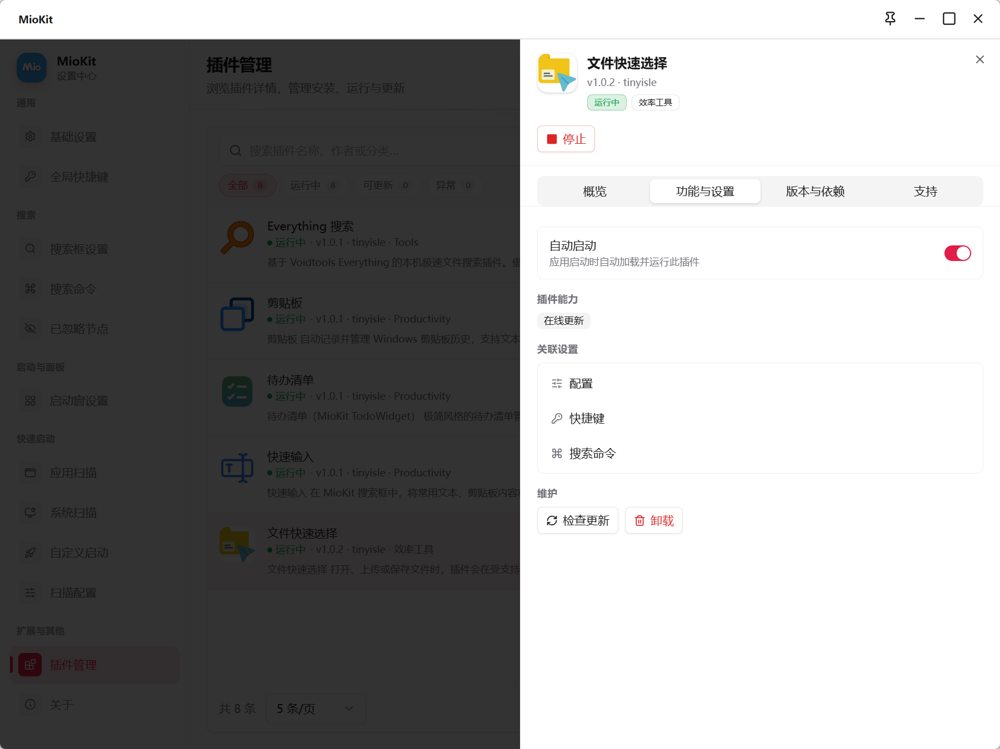

# 插件安装与使用

插件为 MioKit 增加搜索结果、可执行节点、附加操作、搜索作用域以及独立工具界面。输入、剪贴板、计算、待办、终端或文件搜索等具体能力，由已安装且运行的插件提供。

插件与主要调用入口配合使用：先在插件中完成必要配置和内容创建，再将它提供的可执行节点加入启动窗或动作绑定。插件仅提供搜索范围或管理界面时，则按它实际提供的入口使用。

## 找到需要的插件

从 **设置 → 插件管理 → 浏览插件**，或[官方插件页面](https://www.tinyisle.cn/plugins)查看功能、前置条件和安装标识。插件页面中的 Package Id 用于在线安装，它不一定与列表显示名称相同。

选择插件时先确认要完成的任务，以及它是否提供需要的可执行节点、文件搜索范围或界面，避免把所有插件都当成同一种搜索工具。

## 在线安装

1. 打开 **设置 → 插件管理 → 手动安装**。
2. 选择 **在线安装**。
3. 按来源选择 **公共来源** 或 **自定义地址**。
4. 填写插件作者提供的 **插件标识**；自定义来源还要填写准确的源地址。
5. 阅读来源和风险提示，确认后勾选确认框，点击 **确认安装**。
6. 等待结果，按提示完成重启或首次设置，再检查运行状态。

公共来源和自定义来源是不同下载位置。插件标识正确但来源不包含该插件时，仍无法安装，应核对二者组合。

## 从本地包安装

1. 在手动安装窗口切换 **本地插件包**。
2. 拖入一个 `.nupkg`，或点击 **选择文件** 选取。
3. 确认包来源和插件信息，勾选确认后点击 **确认安装**。
4. 根据结果提示处理重启并验证功能。

本地安装每次接收一个包，允许同版本重装，不允许降级。将包放到其他节点拖拽落点不会代替安装步骤。

## 列表、详情与状态

列表可按名称等信息搜索，并按 **全部**、**运行中**、**可更新**、**异常** 筛选。点击插件查看详情，包含以下栏目：

| 栏目 | 查看什么 |
| --- | --- |
| 概览 | 插件介绍、当前状态与常用操作 |
| 功能与设置 | 插件提供的功能和可配置入口 |
| 版本与依赖 | 当前版本、兼容范围、依赖和安装来源 |
| 支持 | 插件提供的帮助与支持信息 |

按钮是否可用取决于插件能力与状态。没有提供主页或配置窗口的插件，不会因此自动拥有一个同类界面。

## 当前运行与下次自动启动

使用列表状态按钮运行或停止插件。停止后，它提供的节点可能暂不可用，原启动窗或动作绑定不代表插件仍在运行。

详情里的 **自动启动** 控制 MioKit 启动时是否自动加载并运行该插件。它与当前开关状态、Windows 是否自启动 MioKit 分别管理。

## 打开工具与配置功能

插件支持时，从对应行或更多操作使用 **打开主页**、**打开配置**。功能设置还可提供配置、快捷键和搜索命令等内容，以插件实际支持的项目为准。

安装后建议完成一次完整流程：

1. 检查运行状态，必要时启动插件。
2. 打开主页或配置，完成路径、内容或其他首次设置。
3. 需要条目的插件先创建一条可用内容。
4. 到搜索框验证其可搜索入口，或到节点面板寻找可执行节点。
5. 将节点拖到启动窗、主面板、轮盘或手势行，再从目标软件调用。

搜索结果与可执行节点是两种能力。节点能绑定动作，不表示一定参与全局搜索；搜索作用域也不等于所有条目都有独立执行节点。

## 更新与测试版

**检查更新** 用于获取可用版本信息，不会立即安装。确认更新后按界面排队处理，重启后生效；出现 **有插件变更需要重启后生效** 时，可使用 **立即重启**。

**允许测试版插件** 位于 **基础设置**，默认关闭。开启后可以安装和更新测试版插件，是否使用由用户按需求选择；版本选择仍需符合当前宿主兼容要求。

## 异常与依赖处理

异常筛选帮助集中查看加载失败或依赖问题。先打开详情阅读原因，确认宿主与插件版本、前置插件和运行环境。界面提供 **补全依赖** 时按提示操作，完成后需要重启的再重启验证。

重复安装不一定能解决配置未完成或缺少依赖的问题。先保留错误信息和复现步骤，便于定位原因。

## 卸载与保留数据

从更多操作选择卸载，阅读确认窗口。卸载会排队在重启后执行，界面允许时可取消排队卸载。

**同时删除插件数据** 默认不勾选。勾选后会清理相应配置、节点数据、插件数据与日志等内容，应结合窗口说明决定；不能把它当成仅移除一个启动窗图标。

卸载或停用后，引用该插件节点的入口可能提示不可用。需要继续使用时恢复插件，确定不再使用时清除或替换绑定。

## 场景与常见问题

安装一个常用输入插件，在插件中创建条目，将可执行节点加入“常用工具”分类并绑定简单手势。分类用于查找和整理，手势用于已经记住的条目；实际输入目标见[上下文说明](context.md)。

**已安装但搜不到？** 查运行状态、重启提示、首次内容创建与搜索能力。**更新后还是旧版本？** 查是否已确认并重启。**入口仍显示但不能用？** 查插件是否停止或被卸载。**只有专用搜索没有节点？** 按该插件提供的搜索范围使用，不强行创建不存在的独立动作。

继续阅读：[节点配置](nodes-and-actions.md) · [搜索作用域](search-commands.md) · [拖拽](drag-and-drop.md)

返回：[产品功能资料](README.md)
