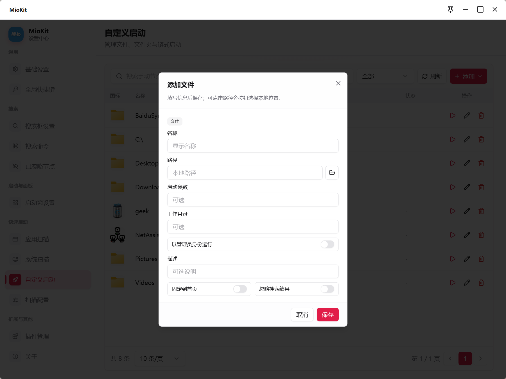
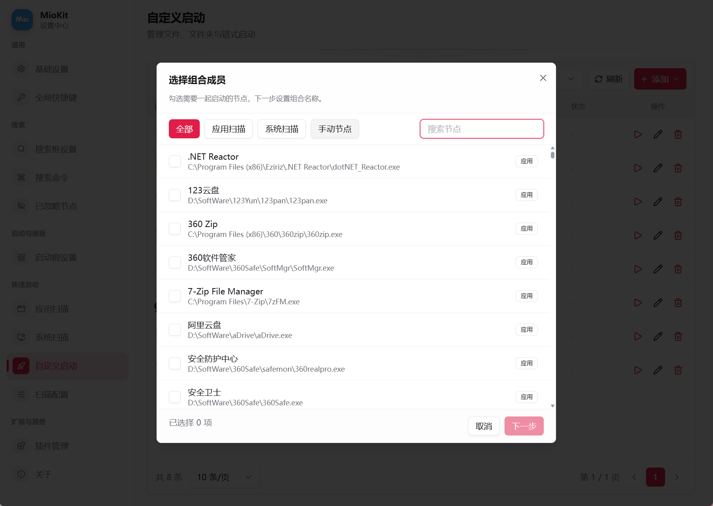
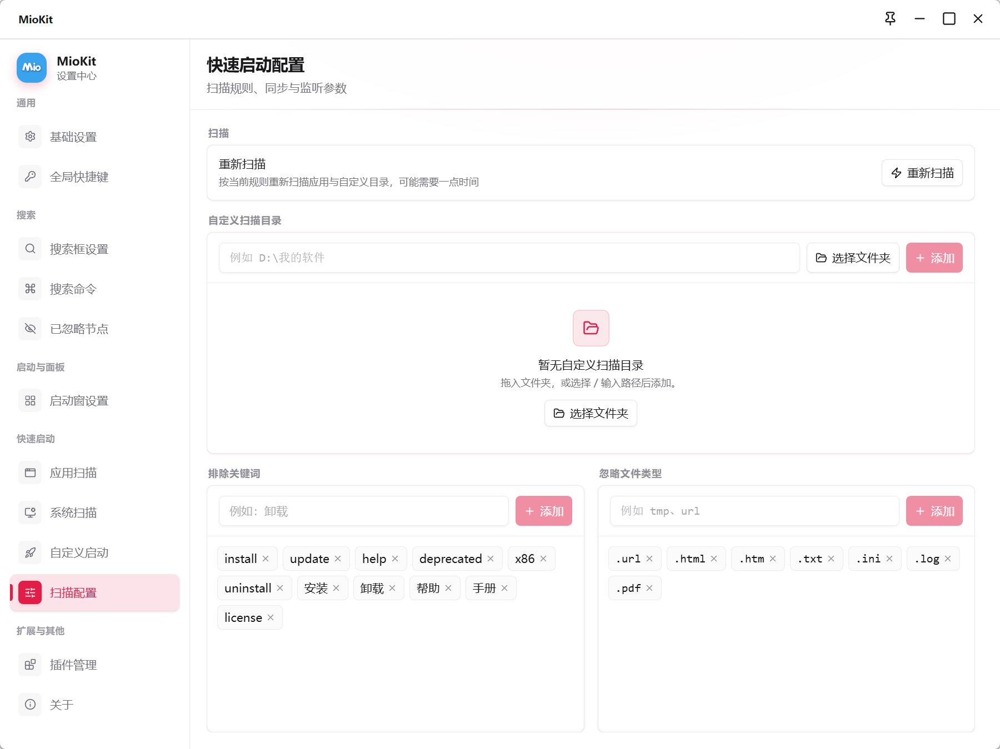

# 快速启动与启动组合

快速启动负责收录和维护可搜索、可绑定的应用与路径。搜索、启动窗、主面板、轮盘和手势调用它提供的节点；管理时进入 **设置 → 快速启动**。

它与启动窗分工不同：快速启动管理原内容和启动方式，启动窗按分类组织这些内容的入口。

## 四个管理页面

| 页面 | 内容 | 常用操作 |
| --- | --- | --- |
| 应用扫描 | 桌面与商店应用 | 搜索名称、路径或别名，筛选 Win32/商店应用，固定、忽略与编辑 |
| 系统扫描 | 控制面板、Windows 设置 | 搜索名称或别名，固定、忽略与编辑 |
| 自定义启动 | 手动文件、文件夹和启动组合 | 添加、拖入、筛选、刷新、启动、编辑和删除 |
| 扫描配置 | 补充目录、排除关键词、忽略文件类型 | 添加或移除规则，重新扫描 |

应用与系统列表支持分页，先搜索或筛选比逐页翻找更方便。

## 调整应用与系统入口

列表中的 **固定首页** 与 **忽略搜索** 可以直接调整。点击编辑按钮设置别名和说明，输入一个别名后按 `Enter` 添加，最后点击 **保存**。

例如给编辑器添加“写代码”别名，以后可以直接搜这个词。忽略搜索后要恢复，可在原列表关闭开关，或到已忽略节点取消忽略。

固定首页只决定首页访问，不保证关键词搜索排名。忽略搜索不等于卸载应用，也不删除其他面板已经保存的入口。

## 添加文件和文件夹

1. 打开 **自定义启动**。
2. 拖入本地文件或文件夹，可以一次拖入多个；也可从 **添加 → 添加文件 / 添加文件夹** 打开空编辑表单。
3. 检查或填写名称、路径，通过路径旁的浏览按钮重新选择位置。
4. 文件项按需填写参数、工作目录和管理员运行。
5. 设置描述、固定首页和忽略搜索等选项。
6. 单项点击 **保存**；批量内容在标签中逐项检查，点击 **保存全部（数量）**。
7. 回列表点击 **启动**，再从搜索框或常用绑定执行一次。

### 不同类型的可配置内容

| 配置 | 文件 | 文件夹 |
| --- | --- | --- |
| 名称、路径、描述 | 支持 | 支持 |
| 固定到首页、忽略搜索结果 | 支持 | 支持 |
| 启动参数 | 支持 | 不提供 |
| 工作目录 | 支持 | 不提供 |
| 以管理员身份运行 | 支持 | 不提供 |

新建项的参数和工作目录默认留空，管理员运行、固定首页和忽略搜索默认关闭。参数含义由被启动的程序决定；保存前按该程序实际需要填写。

## 修改路径、测试与删除

自定义列表可按文件、文件夹或组合筛选，每行提供启动、编辑和删除。文件移动后编辑原项，重新选择路径，保存并启动测试，避免重复创建同名节点。

删除启动项不会删除磁盘文件或文件夹；删除组合不会删除其成员。但其他位置保存的引用可能失效，需要清除或替换绑定。若只是某个面板不想显示，移除那个入口即可。

## 创建与维护启动组合

组合将多个已收录启动成员放进一个可执行入口，适合每天打开同一组工作资源。

1. 在 **自定义启动 → 添加** 选择 **创建组合**。
2. 从应用扫描、系统扫描、手动节点中搜索并勾选成员，至少选择一个。
3. 下一步填写组合名称、描述、图标和首页选项。
4. 点击 **创建组合**，在列表用 **启动** 检查。
5. 从节点面板把组合加入启动窗，或绑定到主面板、轮盘和手势。

组合不能嵌套另一个组合，不接收任意插件动作。执行时同时发起成员启动，不保证完成先后，也没有逐步等待、延迟或失败后编排规则。

组合图标可用默认或上传图片；上传支持 PNG、JPG、WebP、ICO，最大 **5 MB**。该限制与启动窗卡片的自定义图片规则不同。

### 编辑和失效成员

点击组合 **编辑** 后先回到成员选择，取消旧成员、加入新成员，再到下一步修改资料，点击 **保存修改**。

成员被删除时，列表会显示失效数量，编辑窗口标注 **已失效**；先移除或替换失效成员才能继续。保存后再次启动验证。

## 自定义扫描目录的实际范围

在 **扫描配置 → 自定义扫描目录** 中输入、选择或拖入文件夹，支持同时添加多个目录。规则添加或移除后直接保存，再点击 **重新扫描** 更新结果。

扫描主要用于发现应用和快捷方式，不为目录中的任意文档建立通用文件索引：快捷方式 `.lnk` 会扫描子目录，程序文件 `.exe` 只检查所选目录的第一层。

便携程序位于子文件夹时，添加实际放 `.exe` 的文件夹，或直接将程序收录为自定义文件。只想打开文件夹本身，应添加文件夹启动项，而不是只添加扫描规则。

## 扫描过滤规则

| 规则 | 初始配置 | 使用方式 |
| --- | --- | --- |
| 自定义扫描目录 | 空 | 补充自己的应用目录 |
| 排除关键词 | 空 | 名称包含关键词的扫描项被排除，英文不区分大小写 |
| 忽略文件类型 | `.url`、`.html`、`.htm`、`.txt`、`.ini`、`.log`、`.pdf` | 按扩展名过滤，输入 `txt` 会补为 `.txt` |

例如加入“卸载”关键词，可以减少名称含该词的扫描结果。规则改变后重新扫描，再到列表确认。要找回被排除的内容，移除对应规则后再次扫描。

只想让一个已收录项不参与搜索，用列表的 **忽略搜索** 即可，不需要扩大过滤规则影响其他内容。

## 场景与排查

把便携编辑器所在目录加入扫描，手动收录项目目录与文档，创建“项目 A 开工”组合；在启动窗中同时保留组合和单独节点，既能一起开工，也能单独打开。

**搜不到程序？** 查目录层级、是否重新扫描、过滤规则和忽略开关。**路径存在却启动失败？** 在列表直接启动，检查参数、工作目录和运行权限。**组合缺少插件工具？** 它只选择支持的快速启动成员，插件节点应单独加入合适入口。

继续阅读：[启动窗](launcher.md) · [拖拽](drag-and-drop.md) · [完整场景](workflows.md)

返回：[产品功能资料](README.md)
