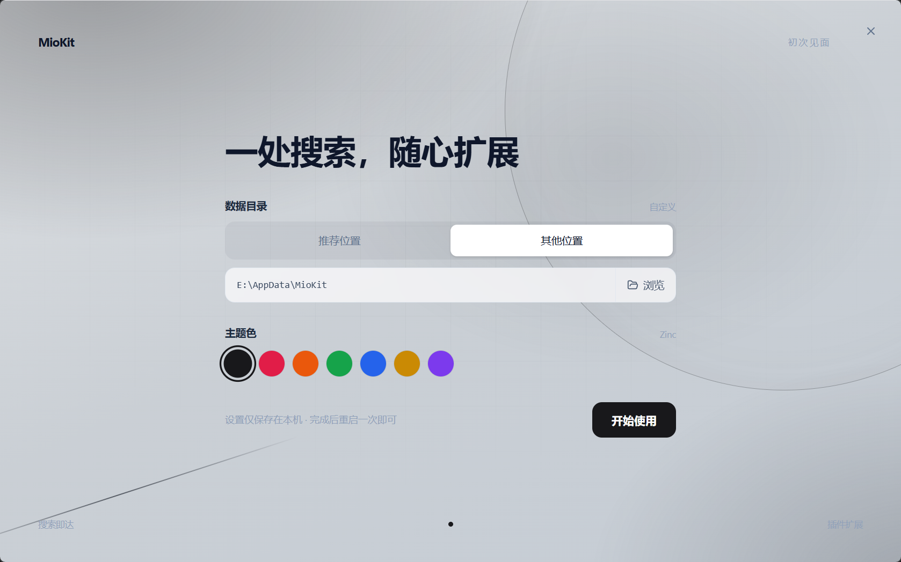
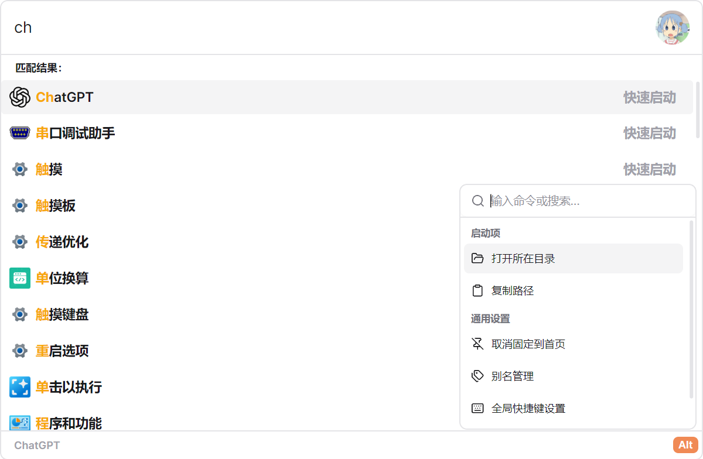
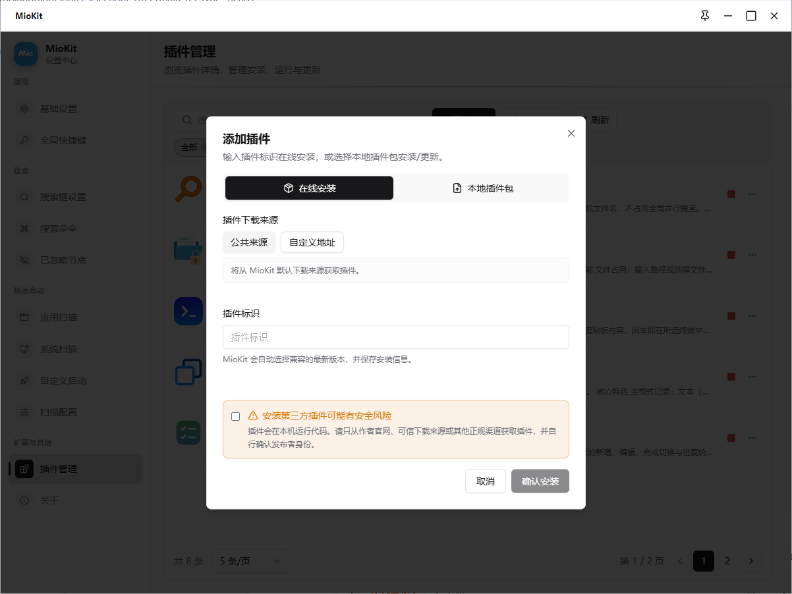
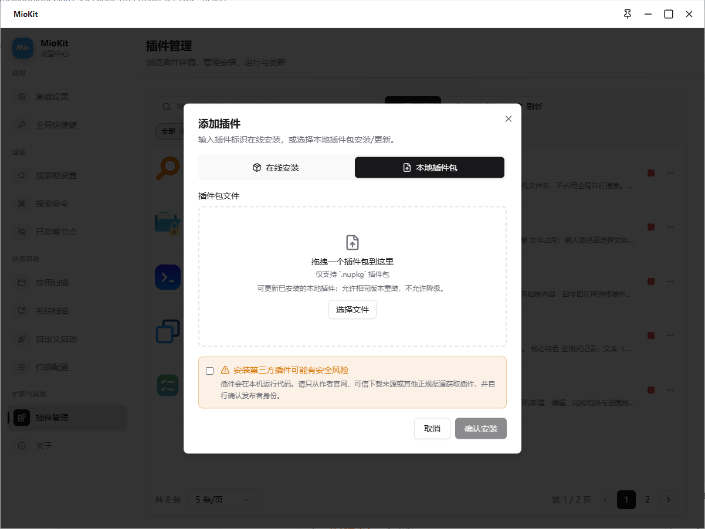

# 用户指南

本页面从安装和第一次搜索开始，介绍各功能入口。想查看具体配置，可以从下面选择教程：

| 想做什么 | 阅读教程 |
| --- | --- |
| 理解节点，把功能绑定到不同入口 | [节点与动作配置](guide/actions.md) |
| 按分类整理应用、文档和文件夹 | [启动窗](guide/launcher.md) |
| 呼出格子面板，随当前软件显示动作 | [主面板](guide/main-panel.md) |
| 按住鼠标按钮选择动作 | [轮盘](guide/radial-menu.md) |
| 用鼠标轨迹直接执行功能 | [鼠标手势](guide/mouse-gestures.md) |
| 拖入节点、文件和文件夹 | [拖拽与节点面板](guide/drag-and-drop.md) |
| 设置启动参数、扫描目录或启动组合 | [快速启动](guide/quick-launch.md) |
| 照着例子搭建自己的工作流 | [使用场景](guide/workflows.md) |

## 安装

MioKit 可从 Microsoft Store 下载并安装：

[下载并安装 MioKit](https://apps.microsoft.com/detail/9n64fzj6nsk3)

打开链接后，点击 **获取** 或 **安装**，按照 Microsoft Store 的提示完成下载和安装。

## 首次启动

第一次启动 MioKit 时，需要完成基础设置：

1. 使用 **推荐位置** 保存数据，或选择 **其他位置**，输入路径或点击 **浏览** 选择目录。
2. 选择喜欢的主题。
3. 点击 **开始使用**，等待初始化、应用扫描和图标准备完成。
4. 页面显示 **一切就绪** 后，点击 **重启并进入**。
5. 重启后按 `Alt + Space` 打开搜索框，搜索一个已安装的应用并按 `Enter`，确认能正常启动。

准备过程中若出现错误，按页面提示检查目录和读写权限，再重试。首次准备尚未完成时，请先完成这一步，再使用快捷键。

## 快速开始

1. 安装后完成首次设置，等待准备完成并点击 **重启并进入**。
2. 按 `Alt + Space` 打开搜索框，输入应用或功能名称，选中结果后按 `Enter`。
3. 按 `Ctrl + Space` 呼出启动窗，创建“常用”分类，拖入一个文件夹；新路径按提示保存添加，再点击图标打开。
4. 按鼠标中键打开主面板，点击空格子选择刚收录的文件夹节点，再点击格子检查结果。

完成后，同一个文件夹已经可以通过搜索、启动窗和主面板打开。之后再按需添加轮盘或手势绑定即可。

各入口的默认操作如下；已经自行修改时，以设置中保存的组合为准：

| 入口 | 默认操作 |
| --- | --- |
| 搜索框 | `Alt + Space` |
| 启动窗 | `Ctrl + Space` |
| 主面板 | 鼠标中键 |
| 轮盘 | 按住鼠标右键并拖动；首次先配置圈层与绑定 |
| 鼠标手势 | 按住侧键 X1 绘制后松开；首次先绑定动作 |

## 日常搜索与执行

按 `Alt + Space` 呼出搜索框，输入应用、文件或功能名称，选择结果后按 `Enter` 执行。支持拼音、首字母、中英文混合及别名匹配；具体文件搜索范围由已启用的功能或插件决定。

结果的右键菜单提供更多操作。可按节点实际提供的选项，固定到首页、设置别名和快捷键、忽略搜索结果，或使用打开所在目录、复制路径等操作。

| 操作 | 键盘方式 |
| --- | --- |
| 选择搜索结果 | `↑` / `↓` |
| 执行选中结果 | `Enter` |
| 展开选中结果的更多操作 | `Alt`，再输入文字筛选操作，用方向键和回车选择 |
| 收起搜索框 | 普通结果列表中按 `Esc`；有菜单或对话框时会先关闭当前菜单或对话框 |

如果进入的是插件管理或工具管理节点，会打开相应窗口；如果是可直接执行的节点，则直接运行它对应的动作。

### 使用 Command 搜索作用域

有些功能提供专用搜索入口。输入已启用功能的完整触发词，例如 `calc`，按 `Tab` 进入，再输入 `12 * 8`。

输入前几个字母时，如果出现对应的灰色补全提示，也可以直接按 `Tab`。补全的是其他功能时，继续输入完整触发词后再按 `Tab`。可用触发词取决于已启用的功能和插件。

不记得触发词时，可以输入 `/` 查看已启用的搜索作用域，选择结果后按 `Enter` 进入；在 `/` 后继续输入名称可缩小范围。这里展示的是搜索作用域，并非全部可执行节点。

想返回普通搜索时，清空输入后按 `Backspace`。如果当前还有剪贴板上下文，会先解除该上下文；文本还可能填入搜索框，此时清空新输入后再按 `Backspace` 返回。

### 自定义搜索触发词

1. 打开 **设置中心 → 搜索命令**，找到目标功能，打开其编辑窗口。
2. 添加容易记住的小写英文触发词，例如 `my-calc`；可用单个 `-` 或 `_` 分隔英文单词。
3. 点击 **保存**，按页面提示处理格式或冲突问题。
4. 回到搜索框，输入新触发词，按 `Tab` 确认进入的是目标功能。

系统提供的触发词与自己添加的触发词分开显示；自定义时不必重复添加系统已有的词。

详见[功能介绍中的 Command 说明](features.md#command-搜索作用域)。

## 配置常用入口

**启动窗：** 默认按 `Ctrl + Space` 呼出，创建分类，再添加已有节点或拖入文件、文件夹。呼出快捷键和窗口行为在 **设置中心 → 启动窗设置** 中配置。完整步骤见[启动窗教程](guide/launcher.md)。

**主面板：** 默认按鼠标中键呼出，在空格子中添加节点即可使用。需要更改触发方式和布局时，右键托盘图标选择 **动作配置 → 主面板 → 基础设置**。完整步骤见[主面板教程](guide/main-panel.md)。

**轮盘与手势：** 右键托盘图标选择 **动作配置**。轮盘默认使用右键拖动，初始需要先添加可见圈层；手势默认使用侧键 X1，初始需要为轨迹绑定节点。修改基础设置后点击 **保存设置**，再到 **节点绑定** 选择动作。完整步骤见[动作配置教程](guide/actions.md)。

**便捷拖拽：** 搜索 **节点面板**，或在动作配置点击 **全部节点**，把小窗里的节点拖到目标位置。启动窗支持批量拖入本地文件，主面板和动作配置的指定槽位一次只接收单项。详见[拖拽说明](guide/drag-and-drop.md)。

第一次可以只做一个例子：把常用文件夹拖入启动窗，再把同一个节点拖到主面板或轮盘。确认好用后再增加应用专属配置和手势，更多例子见[使用场景](guide/workflows.md)。

## 设置与个性化

右键托盘图标选择 **设置**，打开设置中心。

| 页面 | 可以调整什么 |
| --- | --- |
| 基础设置 | 明暗模式、主题色板、自定义色板和导入导出、开机自启动、全屏免打扰、重建图标 |
| 全局快捷键 | 查看、修改和移除已配置快捷键的节点 |
| 搜索框设置 | 呼出快捷键、位置、图标、欢迎语、最近使用等 |
| 搜索命令 | 支持 Command 的功能及用户自定义触发词 |
| 已忽略节点 | 查找并恢复不参与搜索匹配的节点 |
| 启动窗设置 | 呼出快捷键、位置大小、外观、隐藏行为与记住分类 |
| 快速启动各页 | 应用与系统入口、自定义文件和组合、扫描目录与过滤规则 |
| 插件管理 | 安装、运行、更新和卸载插件，查看功能设置 |
| 关于 | 版本信息与反馈入口 |

主题模式可选择 **跟随系统**、**亮色** 或 **深色**。色板支持新增、自定义及导入导出。图标异常时，可在基础设置使用 **重建图标**，完成后重新查看。

开机自启动若由 Windows 管理，按页面提示打开 Windows 启动应用设置。全屏中快捷键不响应时，也应检查 **全屏免打扰**；主面板另有自己的全屏禁用与例外设置。

数据目录在首次启动时选择。保留或备份资料时，请同时留意插件自己的数据位置；不要把首次设置的数据目录选择当作已有数据的迁移工具。

### 恢复被忽略的节点

在 **设置中心 → 已忽略节点** 中找到目标并恢复，再回到搜索框测试。快速启动库中的应用和系统入口，也可以在对应扫描列表关闭 **忽略搜索**。

忽略搜索与移除面板绑定用途不同。想让内容不参与搜索时使用忽略；只想从某个分类或格子移走时，在那个入口移除即可。

### 管理节点快捷键

先在支持该操作的结果菜单中设置快捷键。以后需要集中调整时，进入 **设置中心 → 全局快捷键**，搜索节点，录入新组合并在录入面板保存；不再需要时移除该快捷键。

这只改变直接调用节点的组合键。主面板中键、轮盘和手势的鼠标触发方式，仍在各自的动作配置中管理。

## 更新与卸载

Microsoft Store 安装的 MioKit 可通过 Store 管理更新，也可通过 Windows 应用管理卸载。操作前如需保留配置，请先备份所需数据；插件更新在设置中心的 **插件管理** 中处理。

## 插件

### 官方插件

MioKit 作者提供的官方插件会发布在[官方插件页面](https://www.tinyisle.cn/plugins)。插件详情页会介绍功能、前置条件和 Package Id；安装时仍需回到 MioKit 的“插件管理”中完成。

下面以官方插件[快速输入](https://www.tinyisle.cn/plugins/quick-input)为例。它可以把常用文本、剪贴板内容和脚本变成可搜索的输入节点，官方页面给出的 Package Id 是 `MioKit.QuickInput`。

### 在线安装

1. 打开 MioKit 设置中心，进入 **插件管理**，点击 **手动安装**。
2. 在手动安装窗口中选择 **在线安装**。
3. 插件下载来源选择 **公共来源**。官方插件默认发布在这个来源中。

   

4. 在 **插件标识** 输入框中输入 `MioKit.QuickInput`。
5. 阅读安全提示，确认来源可信后勾选风险确认框，点击 **确认安装**。
6. 安装完成后按下 `Alt + Space`，搜索 **快速输入**，确认可以打开插件的管理界面或执行插件提供的功能。

如果插件发布在其他 NuGet 源，可以在第 3 步选择 **自定义地址**，填写插件源地址和插件标识，再按相同流程安装。请以插件作者提供的地址和 Package Id 为准。

### 从本地插件包安装

如果已经取得插件的 `.nupkg` 文件，可以直接从本地安装：

1. 打开 **设置中心 → 插件管理 → 手动安装**。
2. 切换到 **本地插件包**。
3. 将 `.nupkg` 文件拖入文件区域，或点击 **选择文件** 选取插件包。

   

4. 阅读来源与安全提示，勾选确认框，点击 **确认安装**。已有同名插件时，可以更新或重新安装相同版本；本地安装不允许降级。

插件会在本机运行代码。无论使用公共来源、自定义 NuGet 源还是本地插件包，都请确认插件来源可信，并检查插件与当前 MioKit 版本的兼容性。

### 安装后检查与日常管理

1. 回到 **插件管理**，搜索插件名称，确认状态；也可以通过 **运行中**、**可更新** 或 **异常** 筛选。
2. 插件提供界面时，在对应行或更多操作中使用 **打开主页** 或 **打开配置**，完成它自己的首次设置。
3. 查找插件提供的搜索结果，或打开节点面板查找可执行节点；有些插件需要先创建条目，之后才会提供节点。
4. 将需要的节点添加到启动窗，或绑定到主面板、轮盘、手势，执行一次确认效果。

可通过列表的运行状态按钮运行或停止插件。需要更新时使用 **检查更新** 并按窗口提示操作；提示 **有插件变更需要重启后生效** 时，点击 **立即重启** 后再验证。

遇到依赖缺失时，查看异常说明；提供 **补全依赖** 按钮时可按提示处理。卸载从插件的更多操作进入，并按确认窗口完成；停用或卸载后，原来指向插件节点的入口可能暂不可用，可恢复插件或更换绑定。

## 常见问题

**首次启动后快捷键没有反应？** 先确认准备已完成，并点击过 **重启并进入**。若托盘已有 MioKit，再检查实际保存的快捷键、冲突提示和全屏免打扰。

**找不到某个功能？** 先搜索功能名称，或在节点面板中查找；插件功能需要先安装并运行，部分内容还需要在插件内先创建。

**搜不到文件或应用？** 应用先到 **快速启动 → 应用扫描** 查找，便携软件可以添加扫描目录后重新扫描；普通文件可直接拖入收录，其他文件搜索范围由所用搜索插件决定。再检查已忽略节点和扫描过滤规则。

**输入触发词后没有进入专用搜索？** 检查功能或插件是否运行，继续输入完整触发词后按 `Tab`；不确定可用范围时输入 `/` 查看。自定义触发词需要在编辑窗口保存。

**插件安装完成却没有节点？** 检查运行状态及重启提示，打开插件主页或配置完成首次设置，再刷新节点面板。能执行的节点不一定参与全局搜索。

**拖入为什么没有执行？** 拖入负责收录或绑定，添加完成后再点击入口，或使用配置的轮盘、手势触发。

**为什么换个软件，动作也变了？** 主面板、轮盘和手势支持应用专属配置，检查动作配置左侧所选应用和匹配进程。

**快捷键或鼠标按钮冲突？** 检查设置中的冲突提示，为不同入口分配不同组合。可参考[键盘鼠标分工示例](guide/workflows.md#场景五让键盘鼠标各司其职)。

**绑定后提示节点暂不可用？** 先确认对应插件已运行、节点没有被删除，刷新节点面板或更换绑定。移除入口不会卸载插件或删除原文件。

仍无法解决时，按[贡献指南](contributing.md#反馈产品或文档问题)提供版本、入口和复现步骤，便于定位。

继续阅读：[功能介绍](features.md) · [使用场景](guide/workflows.md) · [文档总览](README.md)
